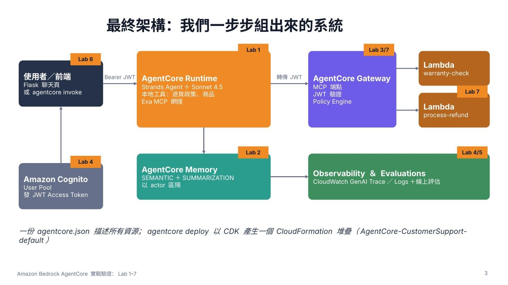

# Amazon Bedrock AgentCore 實戰驗證：Lab 1–7 Step by Step

在全新 AWS 帳號上，逐步實作 AWS 官方工作坊 [Getting started with Amazon Bedrock AgentCore](https://catalog.workshops.aws/agentcore-getting-started/en-US) 的 Lab 1–7。
每一步都附**實際操作截圖**與說明，並把所有指令整理成**可重跑的腳本**。

- 實測日期：2026-11-01
- 區域：`us-east-1`
- 工具：AgentCore CLI `@aws/agentcore@0.30.0`、Strands Agents
- 模型：Claude Sonnet 4.5（原工作坊使用 Sonnet 5.5，見[差異說明](#相對工作坊的差異)）

> 截圖中的 AWS 帳號 ID 已遮蔽。實驗結束後，已依工作坊 Clean Up 步驟刪除所有資源。

📊 **簡報**：[`docs/AgentCore實戰_Lab1-7_StepByStep.pptx`](docs/AgentCore實戰_Lab1-7_StepByStep.pptx)（82 頁）



---

## 目錄與驗證結果

| Lab | 主題 | AgentCore 服務 | 實測結果 | 文件 | 腳本 |
|---|---|---|---|---|---|
| 前置 | CloudShell 工具鏈、前置堆疊、Transaction Search | — | 完成 | [00-prerequisites.md](docs/00-prerequisites.md) | `00-setup-cloudshell.sh` |
| 1 | 建立 Agent 原型：本地工具＋Exa MCP 網搜，部署到雲端 | CLI、Runtime | ✅ 通過（改用 Sonnet 4.5） | [01-lab1-prototype.md](docs/01-lab1-prototype.md) | `lab1.sh` |
| 2 | 長期記憶（語義＋摘要），跨 Session 記得客戶 | Memory | ✅ Sarah 被記住、Alex 隔離 | [02-lab2-memory.md](docs/02-lab2-memory.md) | `lab2.sh` |
| 3 | 以 Gateway 把既有 Lambda 變成 MCP 工具 | Gateway | ✅ 保固查詢正確 | [03-lab3-gateway.md](docs/03-lab3-gateway.md) | `lab3.sh` |
| 4 | Cognito JWT 保護 Runtime 與 Gateway；Trace／Logs | Identity、Observability | ✅ 無 Token → 403 | [04-lab4-security-observability.md](docs/04-lab4-security-observability.md) | `lab4.sh`、`lab4-user-token.sh` |
| 5 | 線上評估＋隨需評估 | Evaluations | ✅ Goal 0.86／Correctness 0.88 | [05-lab5-evaluations.md](docs/05-lab5-evaluations.md) | `lab5.sh` |
| 6 | Flask 聊天前端（瀏覽器直呼 REST API） | Runtime REST API | ✅ API 以 curl 實測 | [06-lab6-frontend.md](docs/06-lab6-frontend.md) | `lab6.sh` |
| 7 | Cedar Policy：退款上限、理由條件 | Policy | ✅ $50 核准、$500 阻擋 | [07-lab7-policy.md](docs/07-lab7-policy.md) | `lab7.sh` |
| 清理 | 移除資源、實測發現、導入建議 | — | 完成 | [08-cleanup-and-findings.md](docs/08-cleanup-and-findings.md) | `99-cleanup.sh` |

---

## 快速開始（AWS CloudShell）

### 0. 前置條件

1. 一個實驗用的 AWS 帳號，以及具管理權限的 IAM 使用者（**不要用 Root**）。
2. 在 Bedrock 主控台送出 **Anthropic 使用案例表單**（新帳號第一次使用 Claude 模型需要）。
3. 依工作坊 *Prerequisites → Part 3* 以 CloudFormation 部署前置堆疊。它會建立 Cognito、兩支 Lambda 與 SSM 參數。本 repo 使用的堆疊名稱是 `agentcore-workshop-prereqs`。
4. 在 CloudWatch 開啟 **Transaction Search**。

### 1. 安裝工具鏈

```bash
git clone https://github.com/ChunPingWang/aws-agentcore-tutorial.git ~/tutorial
cd ~/tutorial
./scripts/00-setup-cloudshell.sh      # Node 22、uv、AgentCore CLI；路徑改到 /tmp/workshop
source ~/.agentcore-env
```

> CloudShell 家目錄只有約 1 GB，因此專案與快取放在 `/tmp/workshop`。CloudShell 重新啟動後 `/tmp` 會清空，需要重新執行上面兩行。

### 2. 依序執行各 Lab

```bash
./scripts/lab1.sh                 # 預設 MODEL=sonnet45；帳號已開通 5.5 可用 MODEL=sonnet55
./scripts/lab2.sh
./scripts/lab3.sh
./scripts/lab4-user-token.sh      # 建立 Cognito 測試使用者並把 Token 寫入 $WORK/.token（請本人執行）
./scripts/lab4.sh
./scripts/lab5.sh
./scripts/lab6.sh
./scripts/lab7.sh
```

- Token 約 1 小時到期，到期後重新執行 `lab4-user-token.sh` 即可。
- `agentcore dev`（Lab 1 的本機互動測試）是 TUI，請手動執行：`agentcore dev --no-browser`。

### 3. 清理

```bash
./scripts/99-cleanup.sh                               # AgentCore 資源＋前置堆疊
DELETE_CDK_BOOTSTRAP=true ./scripts/99-cleanup.sh     # 一併刪除 CDKToolkit（帳號不再用 CDK 時）
```

`99-cleanup.sh` 會依序執行：

1. `agentcore remove all` + `agentcore deploy`
2. 刪除前置堆疊
3. 殘留檢查

CloudWatch 日誌群組不會自動刪除，請確認後手動刪除。

---

## 相對工作坊的差異

| 項目 | 工作坊預設 | 本次實測 | 原因 |
|---|---|---|---|
| 執行環境 | Workshop Studio Code Editor | AWS CloudShell | 自行建立帳號 |
| 模型 | `global.anthropic.claude-sonnet-5-5` | `us.anthropic.claude-sonnet-4-5-20250929-v1:0` | 新帳號送出 use case 後，Sonnet 5.5 仍為 `NOT_AVAILABLE` |
| Lab 6 前端 | Code Editor 埠轉發開瀏覽器 | 以 curl 呼叫同一個 REST API 驗證；UI 用同一份 `index.html` 本機渲染示意 | CloudShell 無法把 8501 埠開給瀏覽器 |
| Cognito 測試使用者 | 學員自行建立 | 由帳號擁有者本人執行 `lab4-user-token.sh` | 密碼與 Token 由本人處理 |

---

## 實測發現

| # | 發現 | 建議 |
|---|---|---|
| 1 | 新帳號需先送 Anthropic use case；Sonnet 5.5 送出後仍未開通 | 提早送表單；`load.py` 保留可切換的模型 ID |
| 2 | `agentcore deploy` 接管線（`\| tail`）看不到進度，看起來像卡住 | deploy 不要接管線 |
| 3 | 主控台其他分頁開啟 CloudShell 面板會搶走同一個 Session（detached） | 只保留一個 CloudShell 分頁 |
| 4 | 模型轉述偶有偏差（耳機類別、音訊退貨條件） | 用線上評估持續監控；關鍵規則放 Policy |
| 5 | 沒有 Policy 時，$500 退款直接核准 | 金額與權限類規則一律放在 Gateway Policy |
| 6 | Lab 2 用自訂 User-Id Header 區隔記憶，這個 Header 可被偽造 | 正式環境以 JWT `sub` 作為 actor（Lab 4 的做法） |

---

## 檔案結構

```
.
├── README.md
├── docs/
│   ├── 00-prerequisites.md … 08-cleanup-and-findings.md   # Step by Step 文件
│   ├── AgentCore實戰_Lab1-7_StepByStep.pptx               # 簡報
│   └── images/                                             # 已遮蔽帳號 ID 的截圖
├── labs/                                                   # 工作坊程式碼（已與工作坊頁面逐檔比對）
│   ├── lab1/  main.py、load.py（5.5）、load_sonnet45.py（4.5）
│   ├── lab2/  session.py、main.py
│   ├── lab3/  warranty_schema.json、client.py、main.py、lambda_index.py（參考）
│   ├── lab4/  main_step3.py、client_step4.py、main_step4.py
│   ├── lab6/  frontend.py、index.html
│   └── lab7/  refund_schema.json
└── scripts/
    ├── lib.sh                    # 共用：路徑、ssm()、uuid()、token()
    ├── 00-setup-cloudshell.sh
    ├── lab1.sh … lab7.sh
    ├── lab4-user-token.sh
    └── 99-cleanup.sh
```

## 免責聲明

本 repo 是個人學習紀錄。程式碼取自 AWS 工作坊，著作權歸原作者所有。測試帳密僅供實驗，正式環境請使用 Authorization Code + PKCE 等正式驗證流程與最小權限 IAM。
