# 前置準備

> [前置準備](00-prerequisites.md)・[Lab 1](01-lab1-prototype.md)・[Lab 2](02-lab2-memory.md)・[Lab 3](03-lab3-gateway.md)・[Lab 4](04-lab4-security-observability.md)・[Lab 5](05-lab5-evaluations.md)・[Lab 6](06-lab6-frontend.md)・[Lab 7](07-lab7-policy.md)・[清理與總結](08-cleanup-and-findings.md)

- CloudShell 工具鏈
- 前置 CloudFormation 堆疊（Cognito、Lambda、SSM）
- Transaction Search 與 X-Ray 索引

對應腳本：[`scripts/00-setup-cloudshell.sh`](../scripts/00-setup-cloudshell.sh)

## Step 1：開啟 CloudShell 確認身分與工具

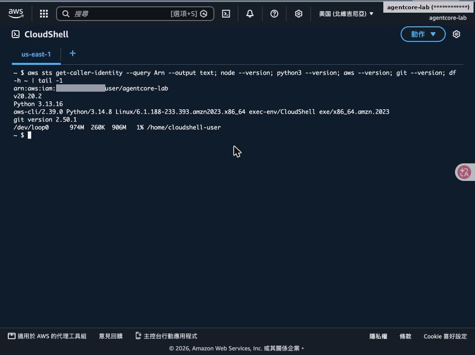

- 以 IAM 使用者 agentcore-lab 登入主控台，區域切到美國東部（維吉尼亞北部）
- aws sts get-caller-identity 確認不是 Root
- CloudShell 內建 Python 3.13、AWS CLI v2、git
- df 顯示家目錄只有約 1 GB → 專案與快取改放 /tmp/workshop

> ⚠️ **注意**：CloudShell 的 /tmp 不會永久保存，Session 結束後需重新執行 00-setup-cloudshell.sh。

## Step 2：執行 00-setup-cloudshell.sh

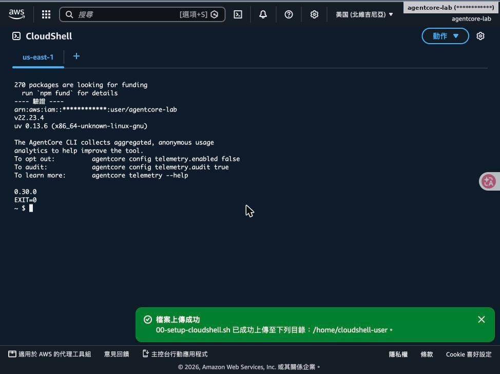

- 以 nvm 安裝 Node.js 22、安裝 uv
- npm i -g @aws/agentcore@0.30.0
- 寫入 ~/.agentcore-env（WORK、NVM、uv/npm 快取都指到 /tmp）
- 結束時印出版本與 EXIT=0

> 💡 **重點**：腳本位於 repo 的 scripts/00-setup-cloudshell.sh，可重複執行。

## Step 3：工作坊 Part 3：部署前置堆疊

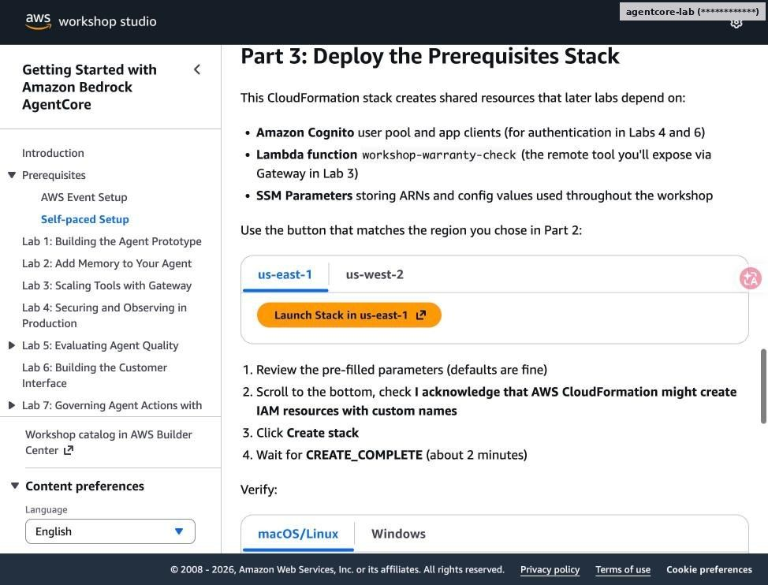

- 前置堆疊會建立：Cognito User Pool 與兩個 App Client
- Lambda：workshop-warranty-check（Lab 3）、workshop-process-refund（Lab 7）
- SSM 參數 /app/customersupport/agentcore/*：ARN、Client ID、Discovery URL
- 依所選區域點 Launch Stack

## Step 4：以快速建立部署 CloudFormation

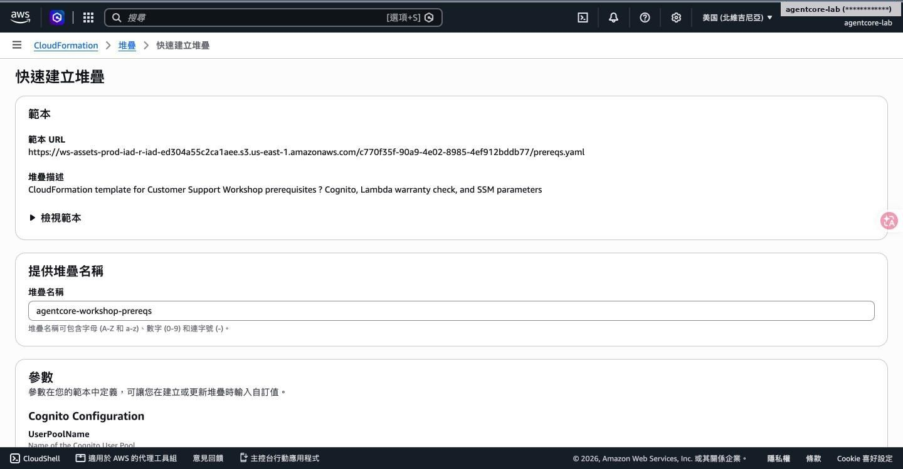

範本 URL 已帶入；堆疊名稱 agentcore-workshop-prereqs（工作坊預設名為 prereqs）

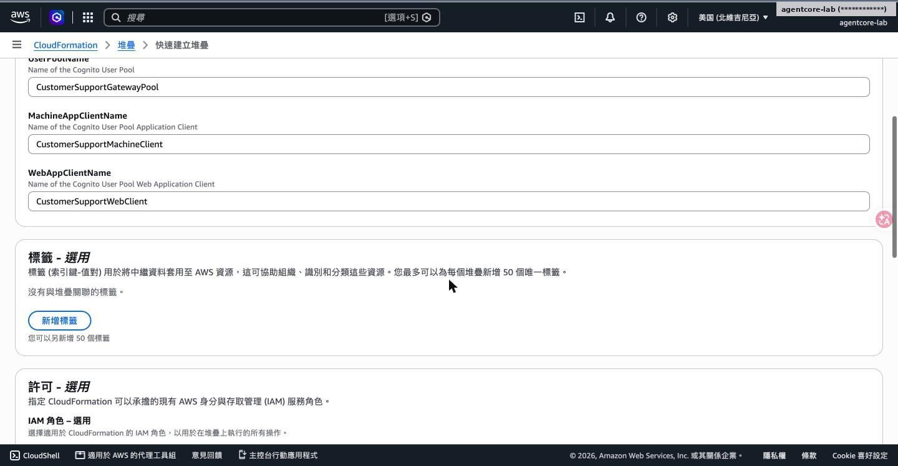

參數保留預設值：使用者池、Machine Client、Web Client 名稱

## Step 5：確認 IAM 權限並等待 CREATE_COMPLETE

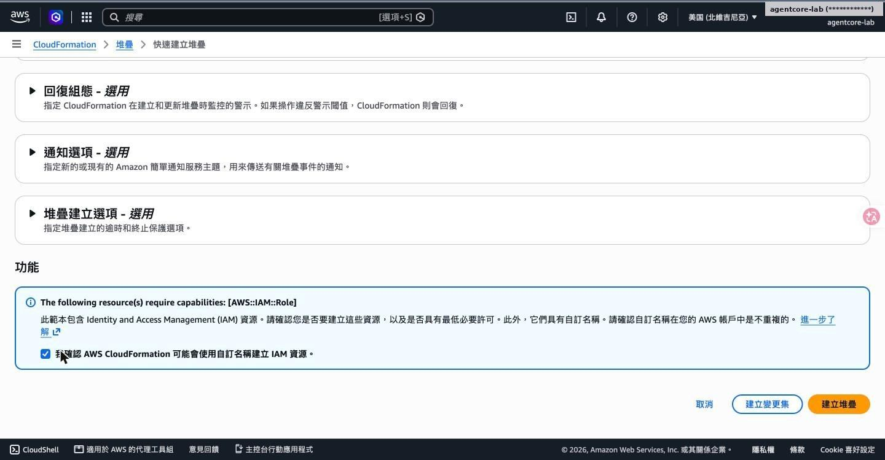

勾選「我確認 CloudFormation 可能建立 IAM 資源」後建立堆疊

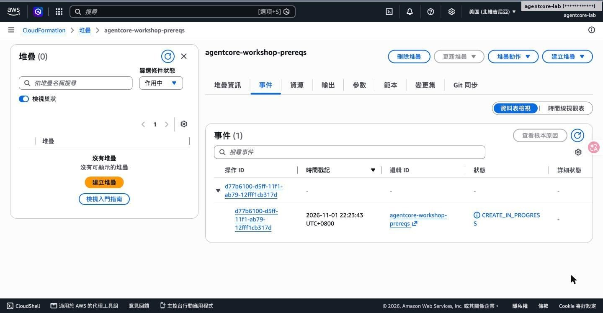

約 2 分鐘後狀態變成 CREATE_COMPLETE

## Step 6：開啟 CloudWatch Transaction Search

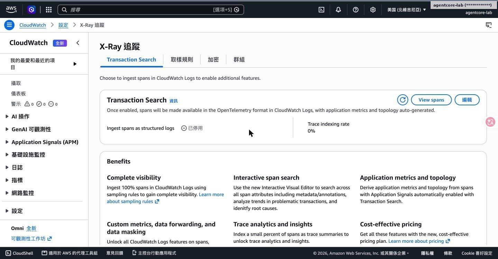

X-Ray 追蹤 → Transaction Search 尚未啟用

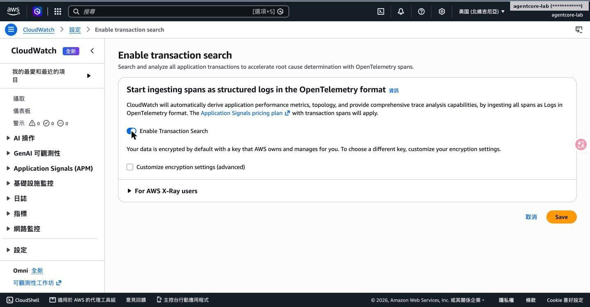

勾選以結構化日誌擷取 Span；AgentCore 的 Trace 依賴這個設定

## Step 7：確認設定生效、索引比例 100%

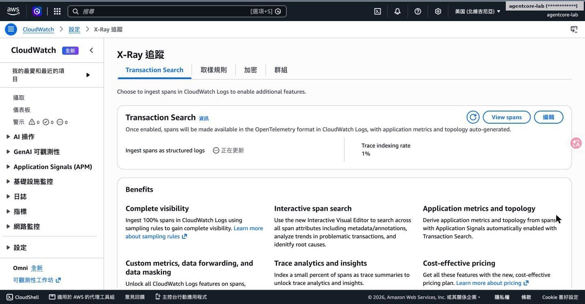

Transaction Search 已啟用

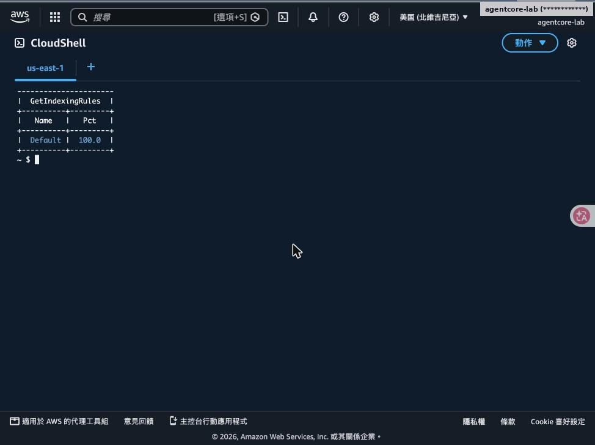

aws xray get-indexing-rules：Default 規則 100%（實驗用，正式環境可調低以控制成本）

## Step 8：上傳教材的 labs/ 與 scripts/

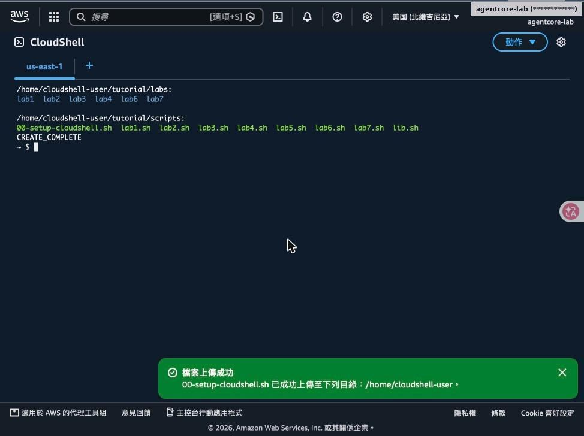

- CloudShell「動作 → 上傳檔案」上傳 tutorial.tgz
- 解壓到 ~/tutorial：labs/lab1…lab7 為工作坊程式碼
- scripts/lab1.sh … lab7.sh 為每個 Lab 的完整指令
- 所有 Lab 程式碼已與工作坊頁面逐檔比對 sha256

> ⚠️ **注意**：上傳不會覆寫同名檔案，重新上傳前先刪除舊檔。

---

[← 回到 README](../README.md)
