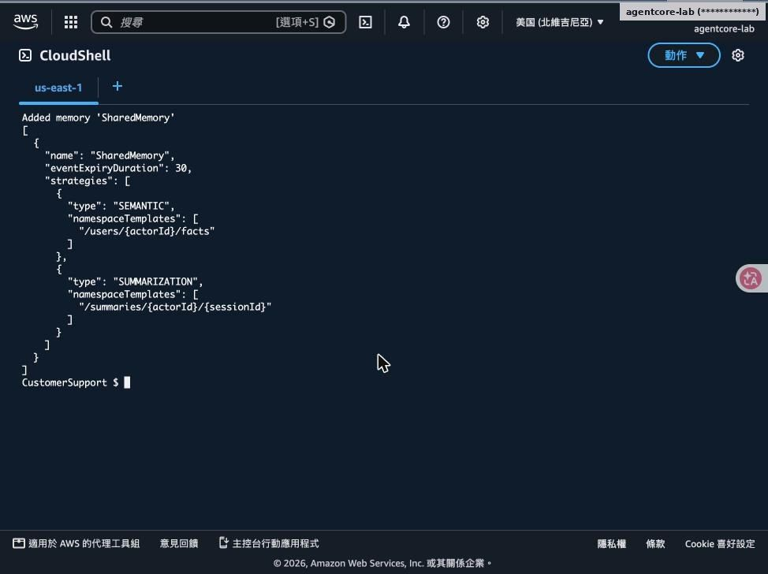
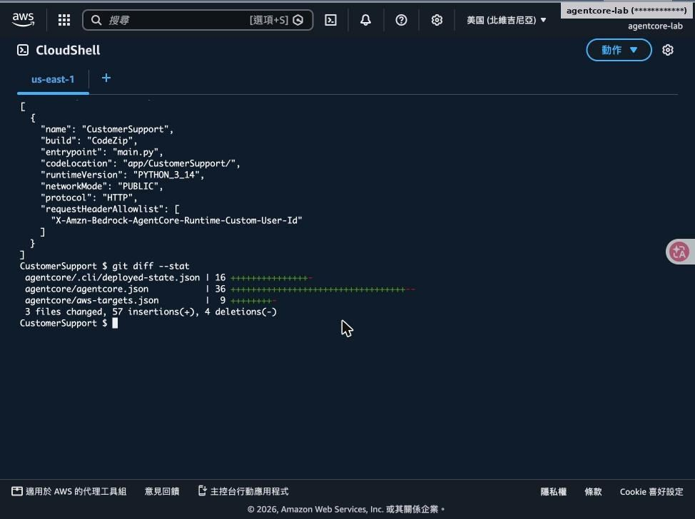
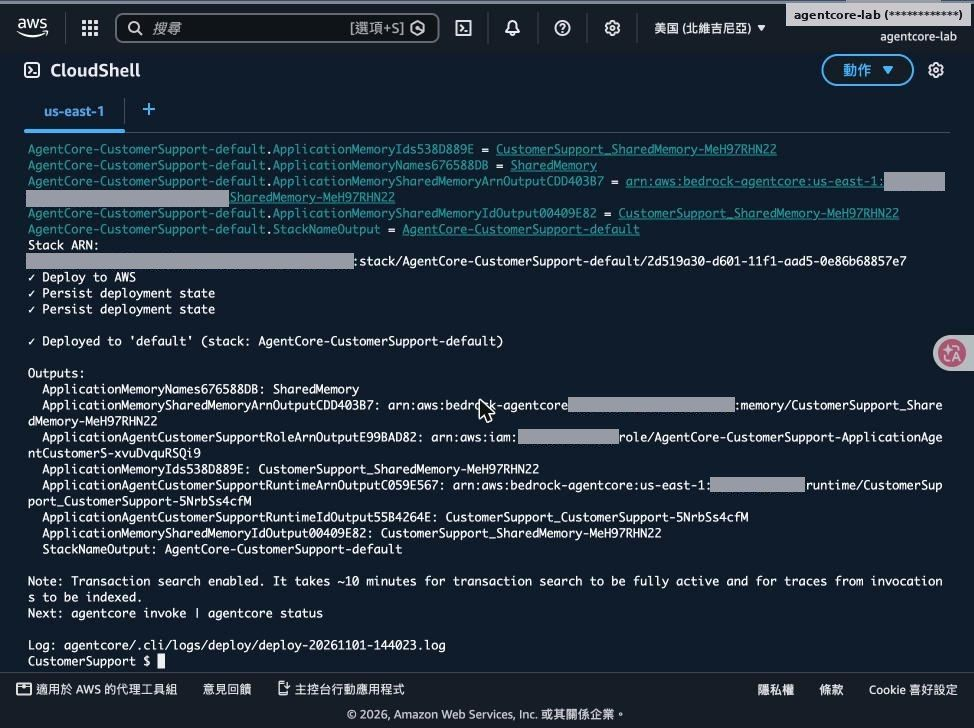
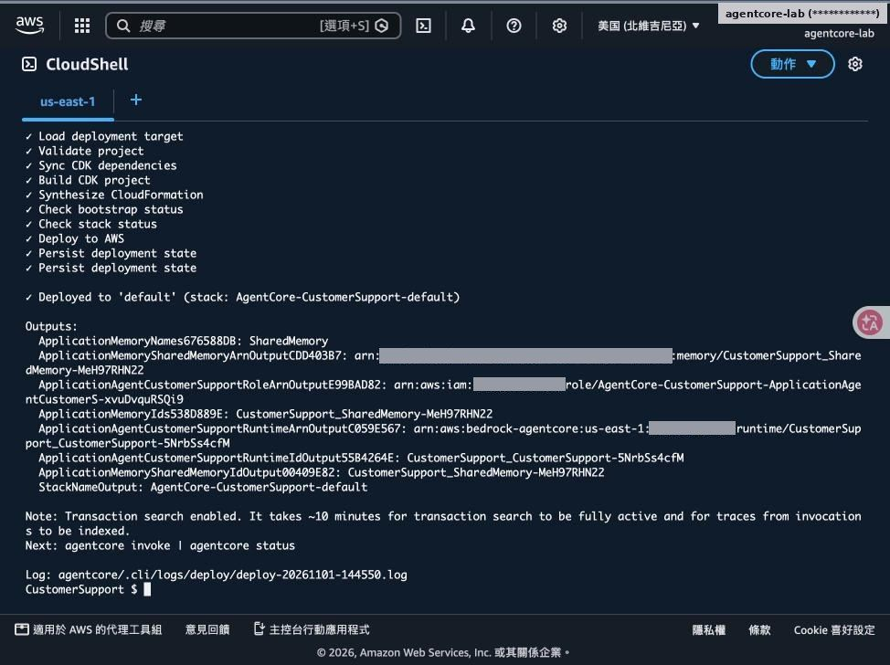
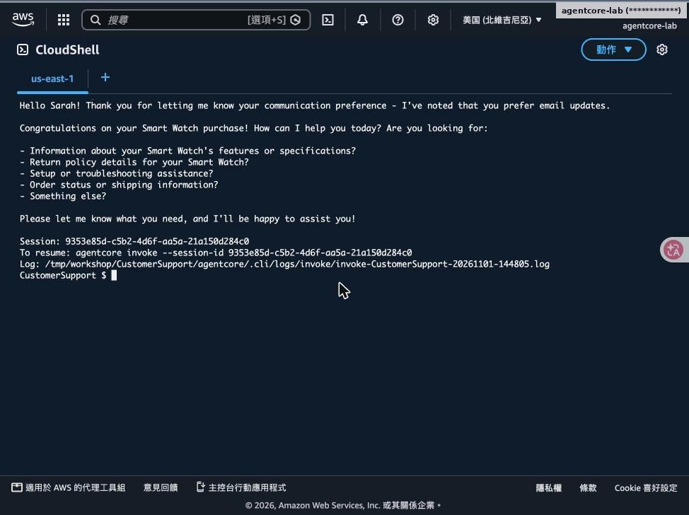
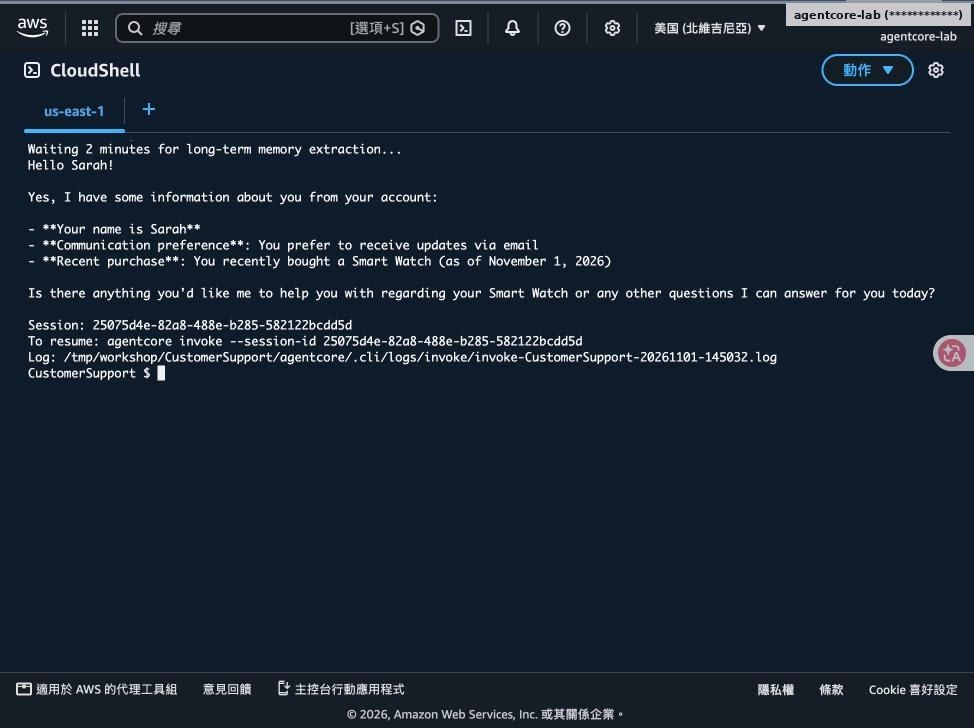
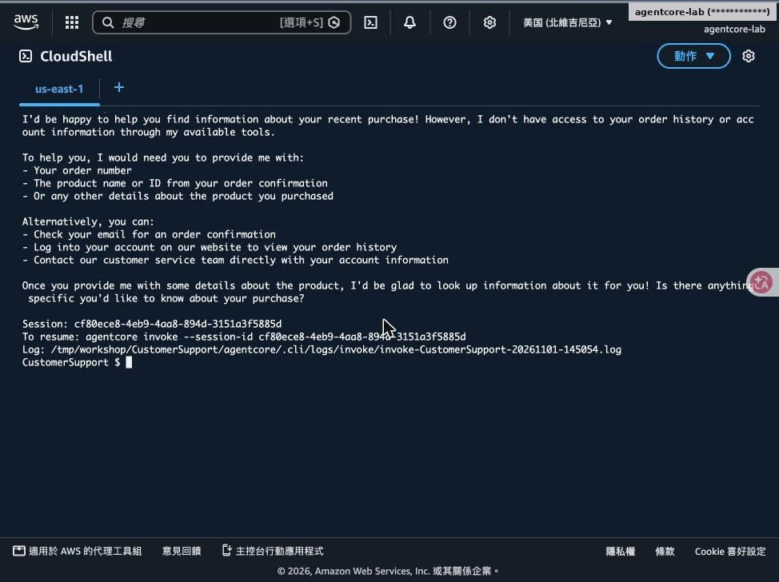
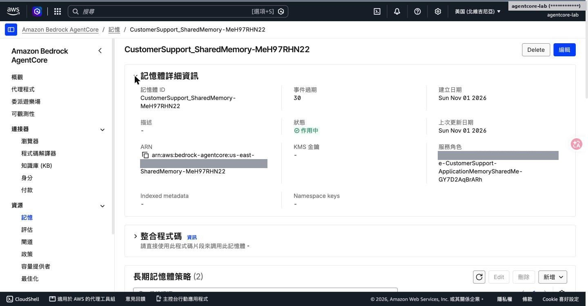
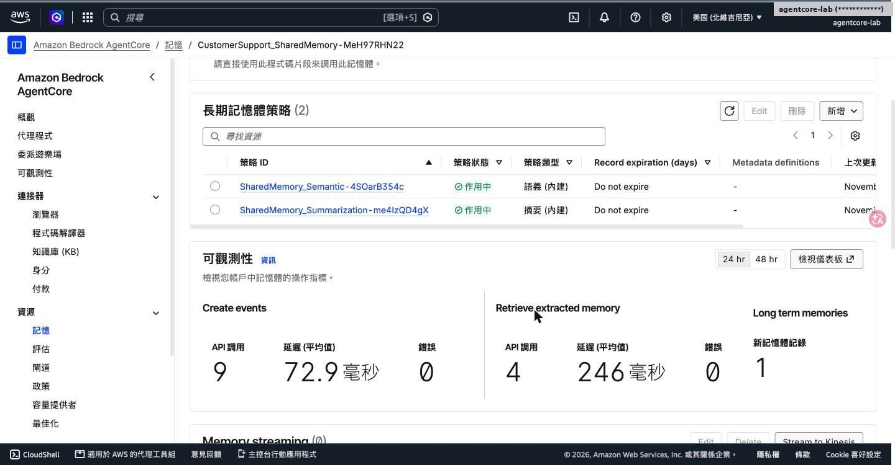
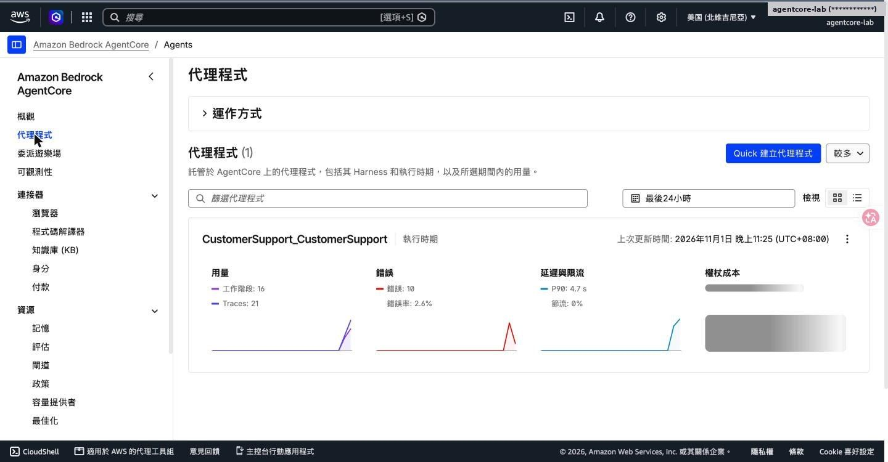

# Lab 2｜加入長期記憶

> [前置準備](00-prerequisites.md)・[Lab 1](01-lab1-prototype.md)・[Lab 2](02-lab2-memory.md)・[Lab 3](03-lab3-gateway.md)・[Lab 4](04-lab4-security-observability.md)・[Lab 5](05-lab5-evaluations.md)・[Lab 6](06-lab6-frontend.md)・[Lab 7](07-lab7-policy.md)・[清理與總結](08-cleanup-and-findings.md)

- Memory：SEMANTIC（事實）＋SUMMARIZATION（摘要）
- 以 Custom-User-Id Header 區隔使用者

對應腳本：[`scripts/lab2.sh`](../scripts/lab2.sh)

## Step 1–4：新增 Memory 與允許自訂 Header



agentcore add memory --name SharedMemory --strategies SEMANTIC,SUMMARIZATION --expiry 30



requestHeaderAllowlist 加入 X-Amzn-Bedrock-AgentCore-Runtime-Custom-User-Id

## session.py：把記憶接到 Strands

```
def get_memory_session_manager(session_id, actor_id):
    config = AgentCoreMemoryConfig(
        memory_id=MEMORY_ID,
        session_id=session_id,
        actor_id=actor_id,
        retrieval_config={
          f"/users/{actor_id}/facts":
              RetrievalConfig(top_k=3, relevance_score=0.5),
          f"/summaries/{actor_id}/{session_id}":
              RetrievalConfig(top_k=3, relevance_score=0.5),
        })
    return AgentCoreMemorySessionManager(config, REGION)

# main.py
user_id = context.request_headers.get(
  "X-Amzn-Bedrock-AgentCore-Runtime-Custom-User-Id")
agent = get_or_create_agent(session_id, user_id)
```

**兩層記憶**

- 短期：同一 Session 的對話事件
- 長期 facts：依 actor 抽取的事實（名字、偏好、購買）
- 長期 summaries：每個 Session 的摘要
- actor_id 決定隔離範圍，是安全邊界

> 程式碼為節錄，完整版在 labs/lab2/session.py。

## Step 5：部署 Memory



第一次加 Memory 的部署，建立 SharedMemory 與兩個策略



以 Sonnet 4.5 版本重新部署完成，輸出 Memory ARN／ID

## Step 6：Session A：Sarah 自我介紹



- invoke 帶 --session-id $SESSION_A 與 -H Custom-User-Id: Sarah
- 「我叫 Sarah，偏好 Email 通知，最近買了 Smart Watch」
- Agent 確認偏好並主動提供後續協助

## Step 7：等 2 分鐘，新 Session B 問「你知道我什麼？」



- 長期記憶抽取是非同步的，工作坊建議等 2 分鐘
- 全新 Session ID，同一位使用者 Sarah
- Agent 正確說出名字、Email 偏好、購買 Smart Watch 與日期

> 💡 **重點**：這就是「跨 Session 記得客戶」：Session 不同，但 actor 相同。

## Step 8：換成 Alex：確認記憶隔離



- Custom-User-Id: Alex 問「我剛剛買了什麼？」
- Agent 表示沒有訂單資訊，請提供細節
- Sarah 的記憶不會外洩給其他使用者

> ⚠️ **注意**：Lab 2 的 user id 來自自訂 Header，任何人都能偽造；Lab 4 改由 JWT 的 sub 取得。

## 主控台：Memory 資源與策略



記憶體詳細資訊：事件過期 30 天、狀態作用中



兩個內建策略（語義、摘要）；可觀測性顯示 Create events 與擷取次數

## Step 9：主控台：代理程式總覽



- Bedrock AgentCore → 代理程式
- CustomerSupport_CustomerSupport 執行時期
- 工作階段、Trace、錯誤率、P90 延遲一目了然
- 錯誤數來自前面模型未開通時的呼叫


---

[← 回到 README](../README.md)
