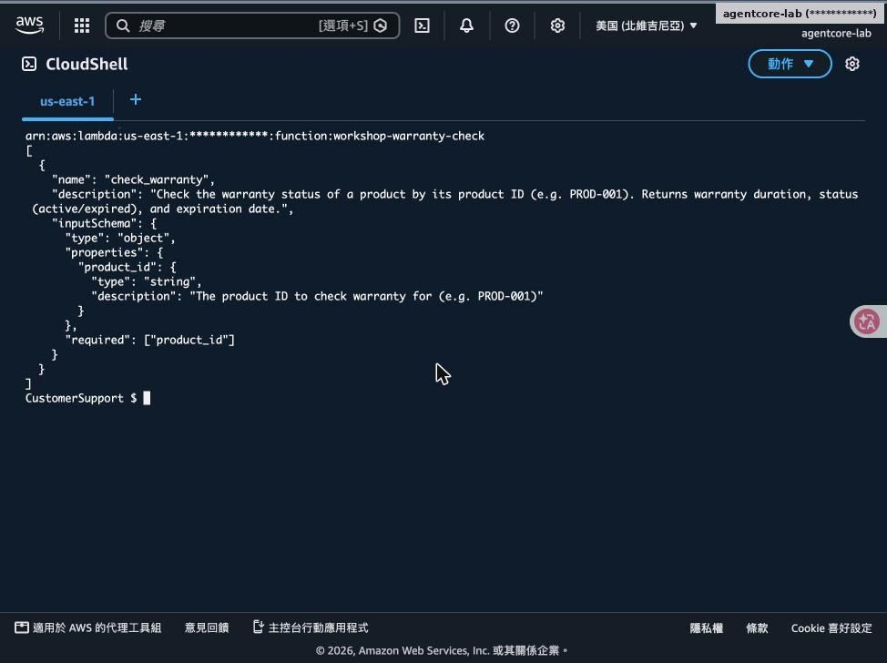
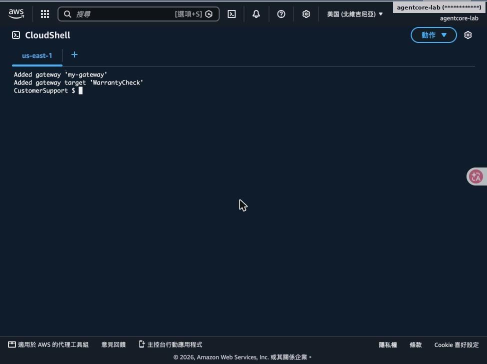
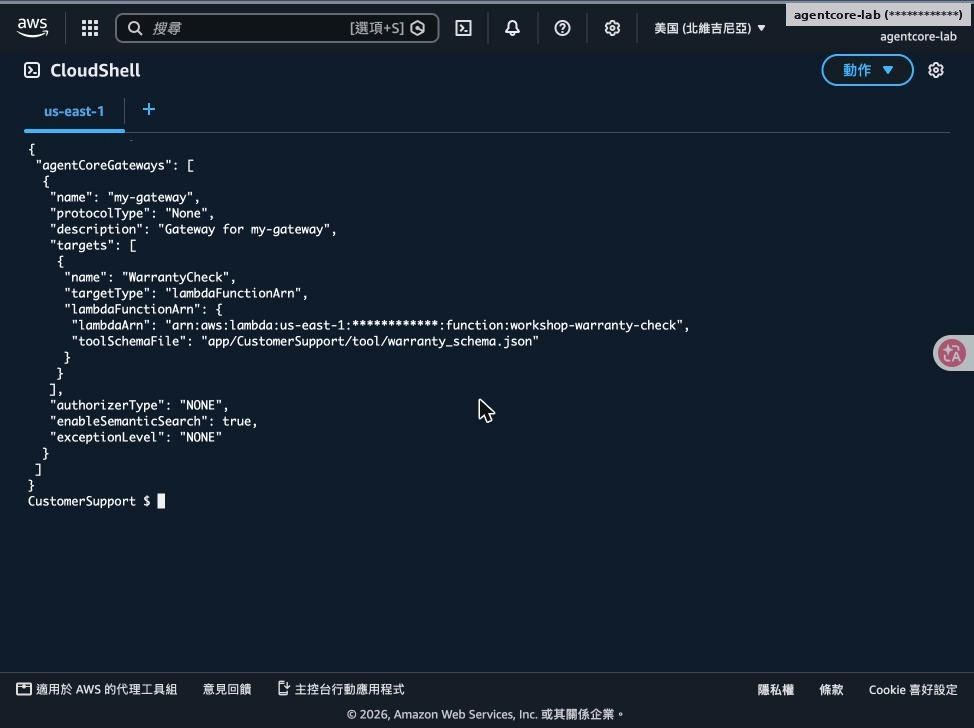
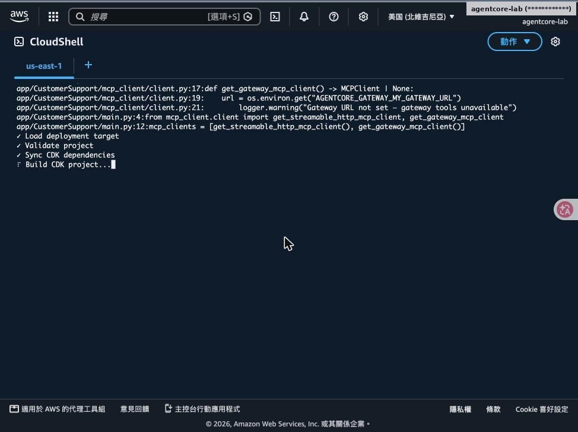
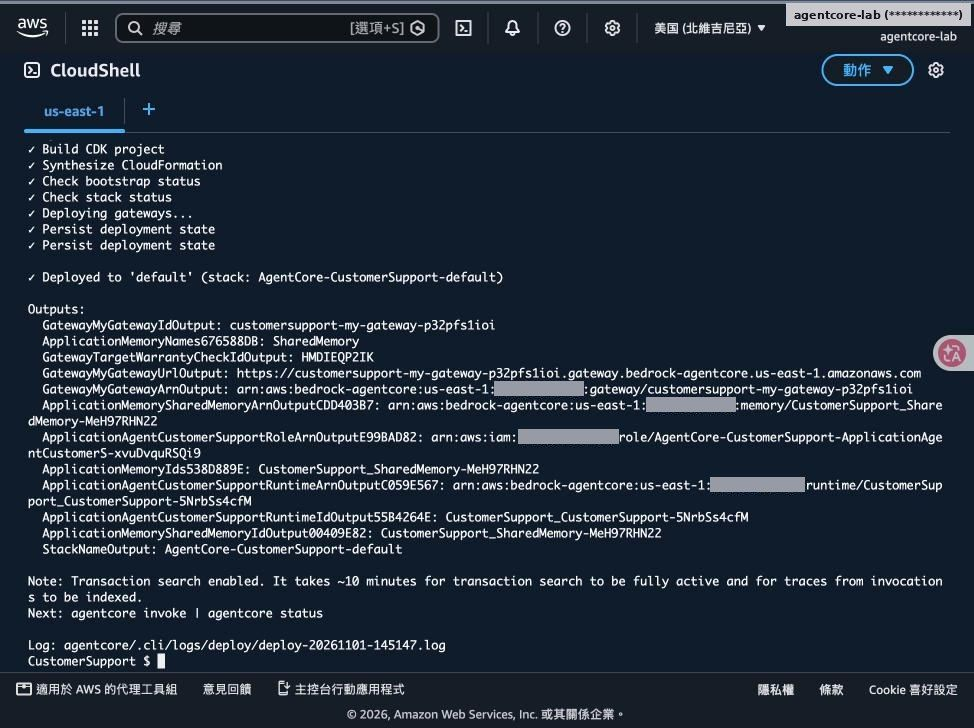
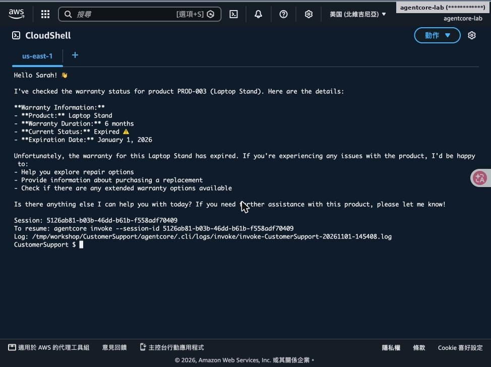
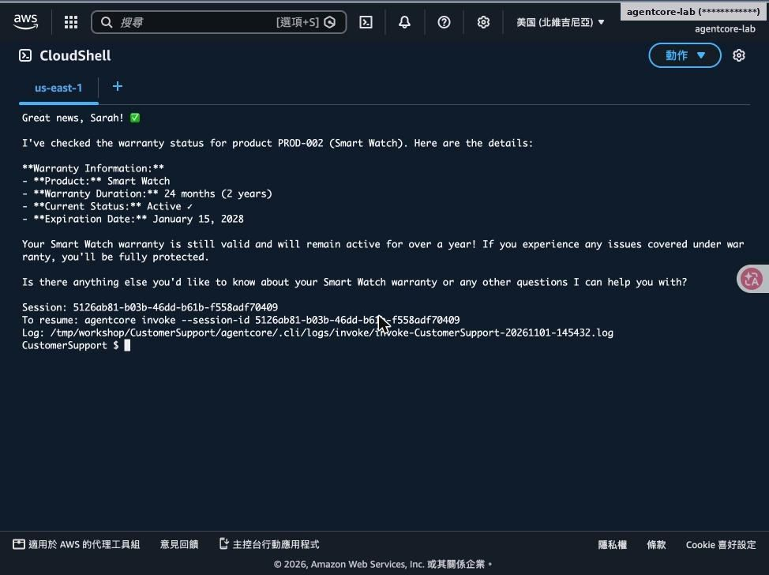
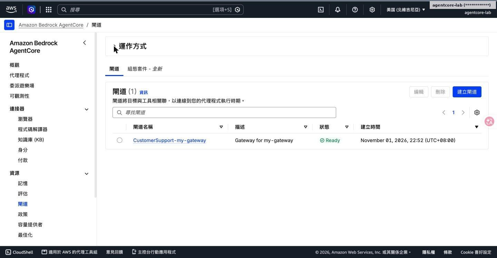
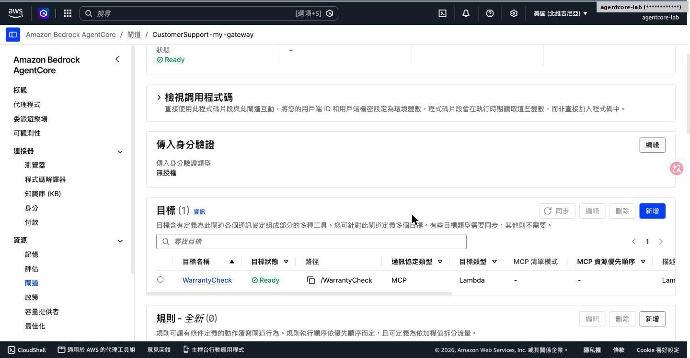

# Lab 3｜以 Gateway 把 Lambda 變成 MCP 工具

> [前置準備](00-prerequisites.md)・[Lab 1](01-lab1-prototype.md)・[Lab 2](02-lab2-memory.md)・[Lab 3](03-lab3-gateway.md)・[Lab 4](04-lab4-security-observability.md)・[Lab 5](05-lab5-evaluations.md)・[Lab 6](06-lab6-frontend.md)・[Lab 7](07-lab7-policy.md)・[清理與總結](08-cleanup-and-findings.md)

- 既有 Lambda 不改一行程式
- Gateway 提供 MCP 端點，Agent 自動發現工具

對應腳本：[`scripts/lab3.sh`](../scripts/lab3.sh)

## Step 1：取得 Lambda ARN 與工具 Schema

- 從 SSM 讀 warranty_check_lambda_arn
- warranty_schema.json 定義 check_warranty(product_id)
- description 寫清楚用途與回傳內容，模型靠它選工具

## Step 2：新增 Gateway 與 Lambda Target

agentcore add gateway --name my-gateway；add gateway-target --type lambda-function-arn

agentCoreGateways：WarrantyCheck target、authorizerType NONE（Lab 4 再加上 JWT）

## Step 3：更新 MCP Client 並部署

client.py 新增 get_gateway_mcp_client()，URL 由環境變數 AGENTCORE_GATEWAY_MY_GATEWAY_URL 注入

部署完成：輸出 Gateway URL／ID 與 Target ID

## Step 4：測試保固查詢

PROD-003 筆電架：保固 6 個月，已過期

同一 Session 問 PROD-002 智慧手錶：保固 24 個月，有效至 2028-01-15

## 主控台：Gateway 與 Target

閘道 CustomerSupport-my-gateway：Ready

傳入身分驗證「無授權」；目標 WarrantyCheck 類型 Lambda、協定 MCP

> 注意這時 Gateway 是沒有驗證的，任何知道 URL 的人都能呼叫工具，Lab 4 會修正。

---

[← 回到 README](../README.md)
