# Lab 4｜身分驗證與可觀測性

> [前置準備](00-prerequisites.md)・[Lab 1](01-lab1-prototype.md)・[Lab 2](02-lab2-memory.md)・[Lab 3](03-lab3-gateway.md)・[Lab 4](04-lab4-security-observability.md)・[Lab 5](05-lab5-evaluations.md)・[Lab 6](06-lab6-frontend.md)・[Lab 7](07-lab7-policy.md)・[清理與總結](08-cleanup-and-findings.md)

- Runtime 與 Gateway 都改用 Cognito JWT
- CloudWatch GenAI Observability 查看 Trace

對應腳本：[`scripts/lab4.sh`](../scripts/lab4.sh)

## Step 1–2：status 與 traces

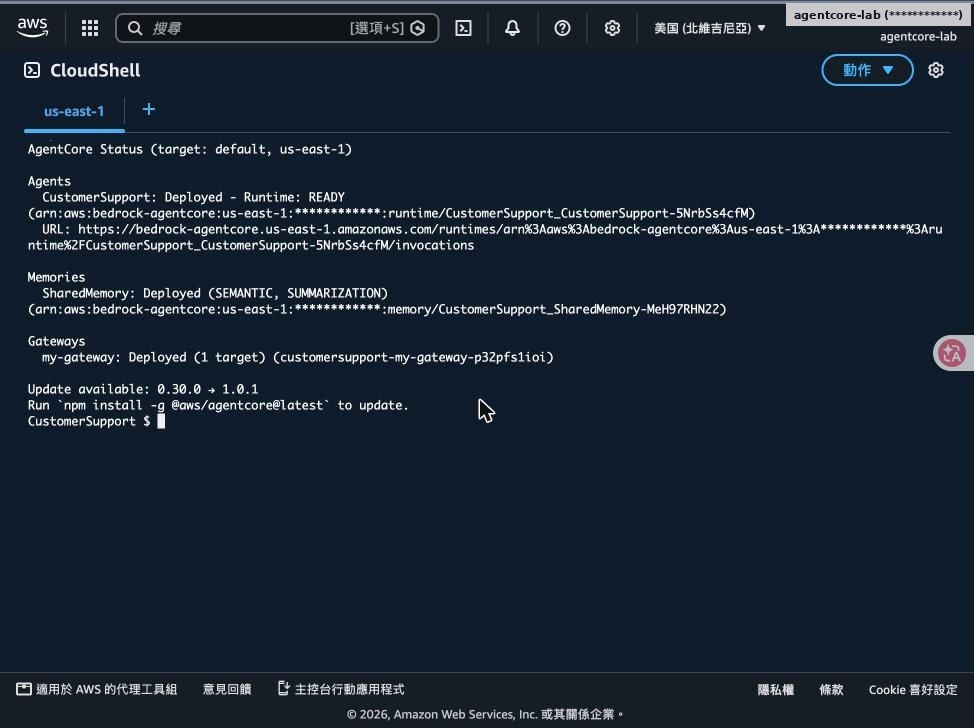

agentcore status：Agent、Memory、Gateway 都已部署

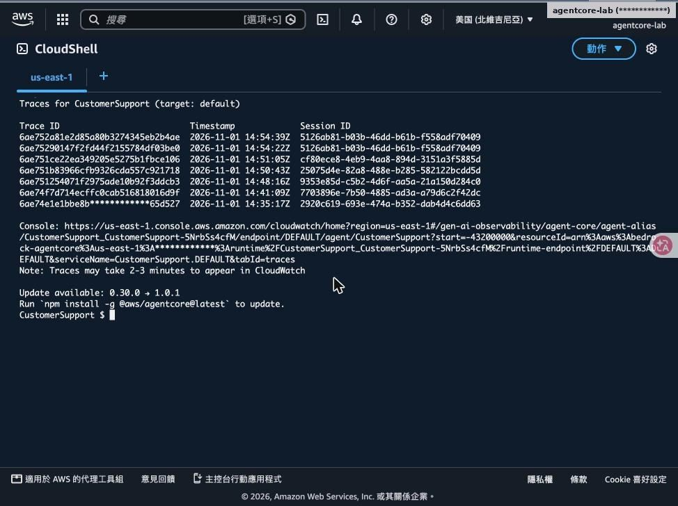

agentcore traces list：每次呼叫的 Trace ID 與 Session ID，附 CloudWatch 連結

## Step 3：agentcore logs 查看執行日誌

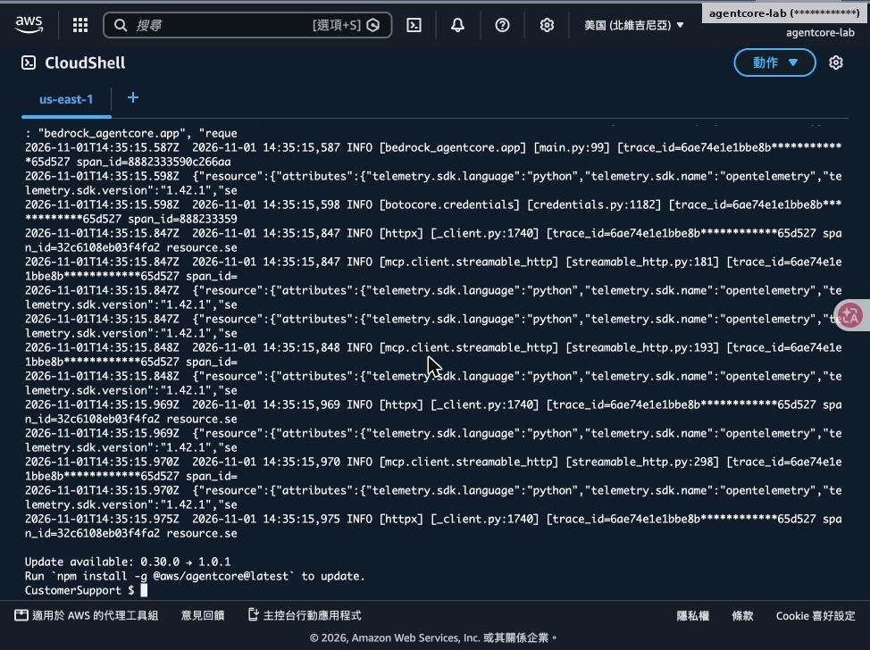

- agentcore logs --since 30m -n 25
- 每行帶 trace_id／span_id，可和 Trace 對照
- 看得到 MCP streamable_http 呼叫過程
- --level、--query 可篩選

## Step 4：Runtime 改用 CUSTOM_JWT

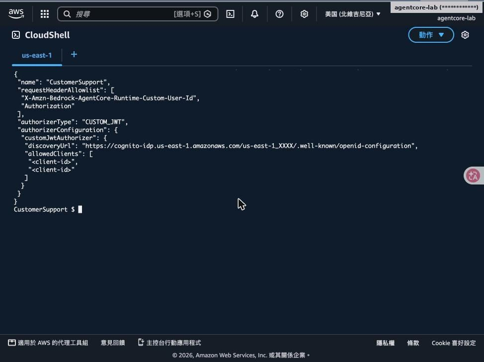

- authorizerType: CUSTOM_JWT
- discoveryUrl 指向 Cognito 的 openid-configuration
- allowedClients：Machine Client 與 Web Client
- Header 白名單加入 Authorization，程式才讀得到 Token

> 💡 **重點**：main_step3.py 以 JWT 的 sub 作為 user_id，取代可偽造的自訂 Header。

## Step 5：加入 pyjwt 並部署

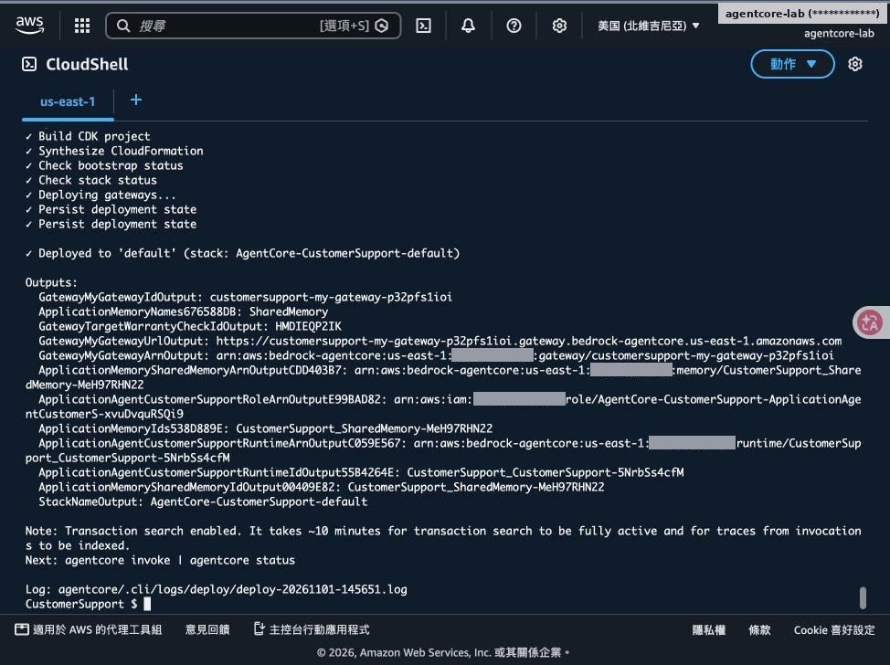

- uv add pyjwt
- 複製 main_step3.py → agentcore validate → deploy
- 部署後未帶 Token 的請求會被拒絕

## Step 6：驗證「沒有 Token 就不能用」

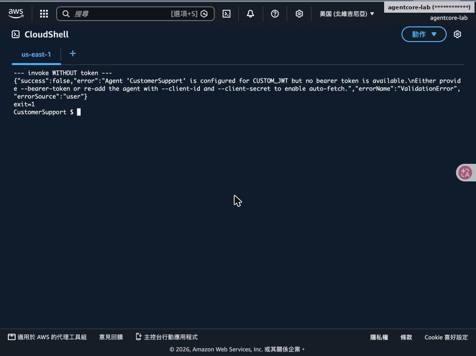

CLI：Agent 設定為 CUSTOM_JWT 但沒有 bearer token → ValidationError

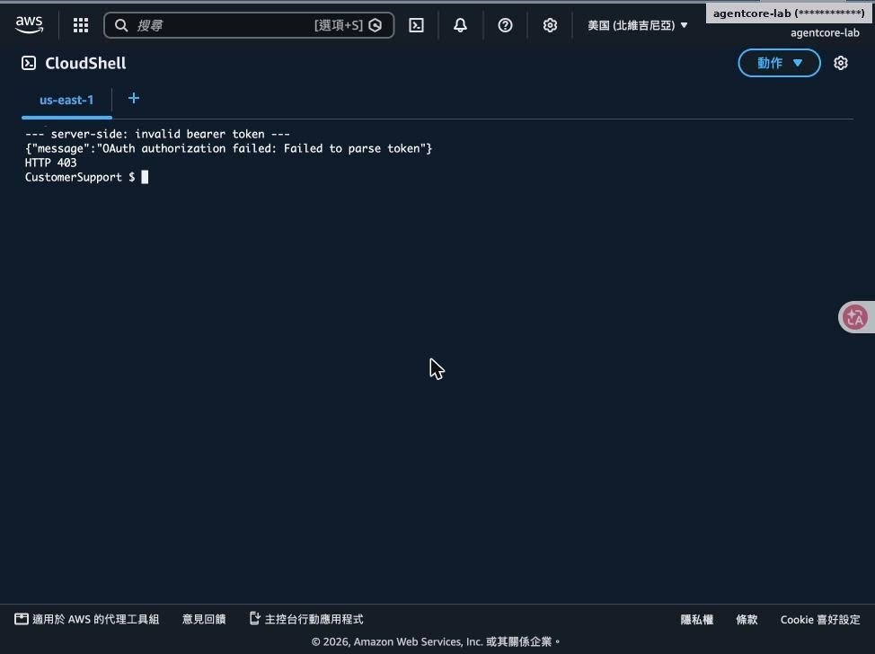

直接打 REST API 帶假 Token：HTTP 403 OAuth authorization failed

## Step 7：建立 Cognito 測試使用者並取得 Token

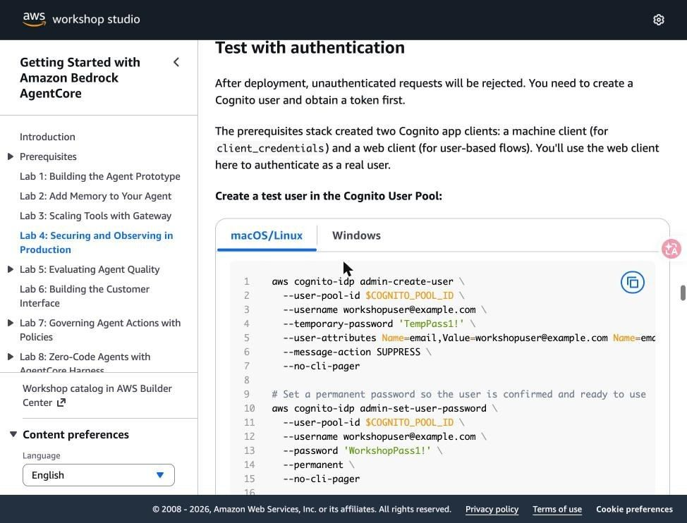

- admin-create-user＋admin-set-user-password（工作坊提供的測試帳密）
- initiate-auth USER_PASSWORD_AUTH 取得 Access Token
- 本次由帳號擁有者本人執行，Token 寫入 /tmp/workshop/.token（權限 600）
- Token 約 1 小時到期，repo 提供 lab4-user-token.sh 重新取得

> ⚠️ **注意**：測試帳密只能用在實驗。正式環境請用 Authorization Code＋PKCE，不要寫死帳密。

## Step 8：帶 Token 呼叫：正常回應

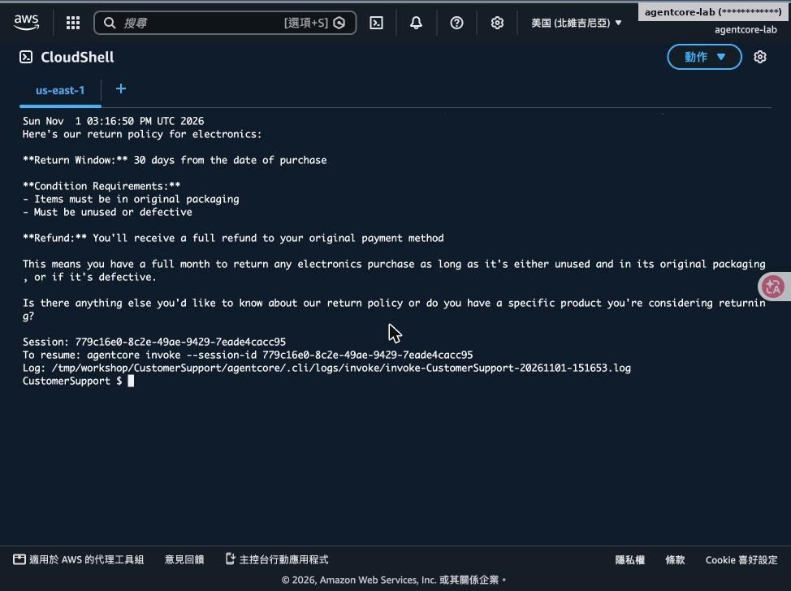

- agentcore invoke … --bearer-token "$(cat $WORK/.token)"
- 電子產品退貨政策正確回覆
- Runtime 驗證 JWT 簽章、發行者與 client_id 後才放行

## Step 9：Gateway 改為 JWT（移除後重建）

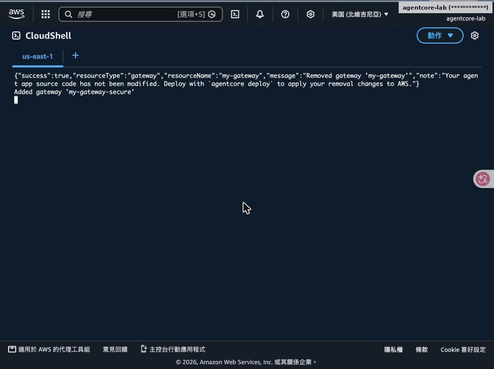

remove gateway my-gateway → add gateway my-gateway-secure --authorizer-type CUSTOM_JWT → 重加 WarrantyCheck

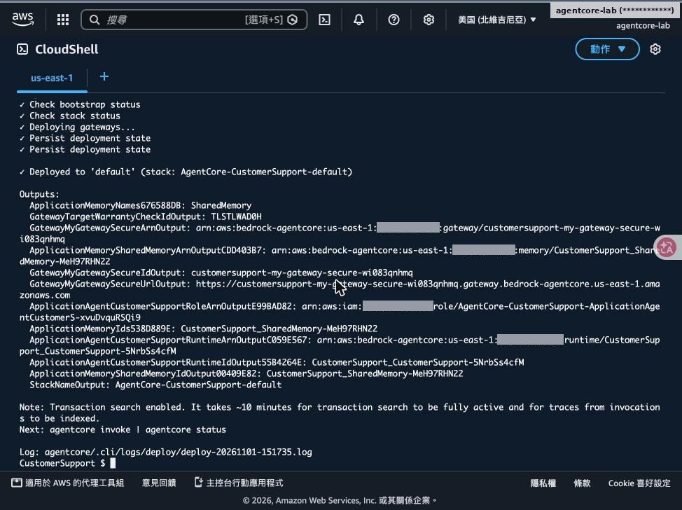

部署完成：新 Gateway URL／ARN

## Step 10：Token 從 Runtime 傳遞到 Gateway

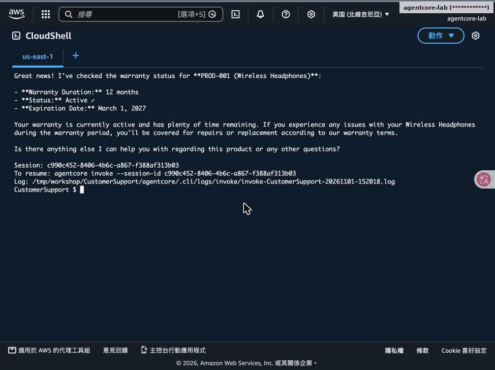

- client_step4.py：MCP Client 帶上收到的 Authorization
- PROD-001 無線耳機：保固 12 個月，有效至 2027-03-01
- 使用者身分一路傳到工具層，Gateway 也能做授權

## Step 11：CloudWatch GenAI Observability

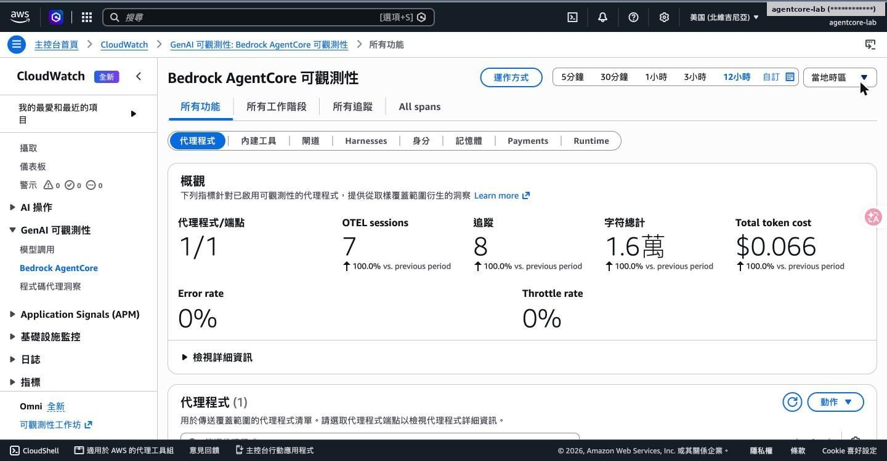

總覽：Session、Trace、Token 成本、錯誤率、節流率

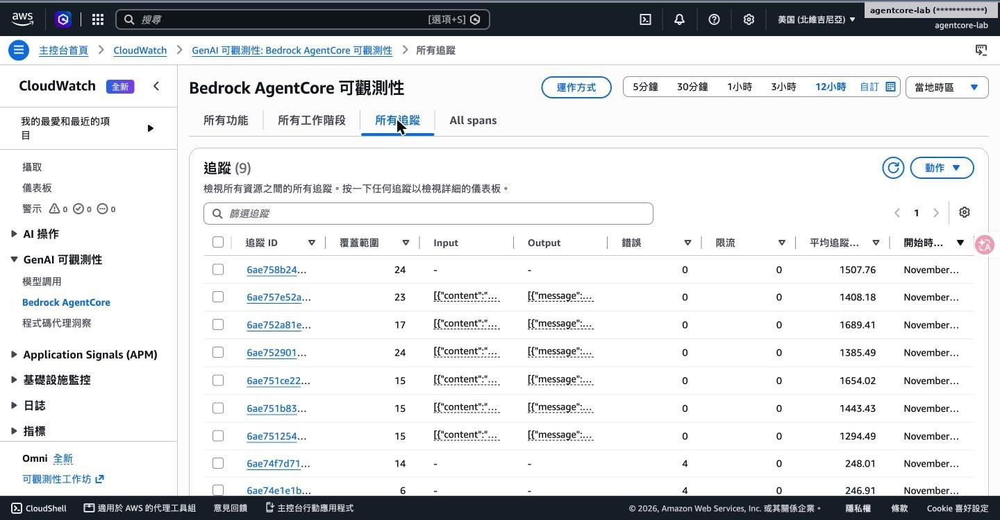

所有追蹤：每筆的 Span 數、Input/Output、延遲

## Step 12：單一 Trace 的 Span 樹

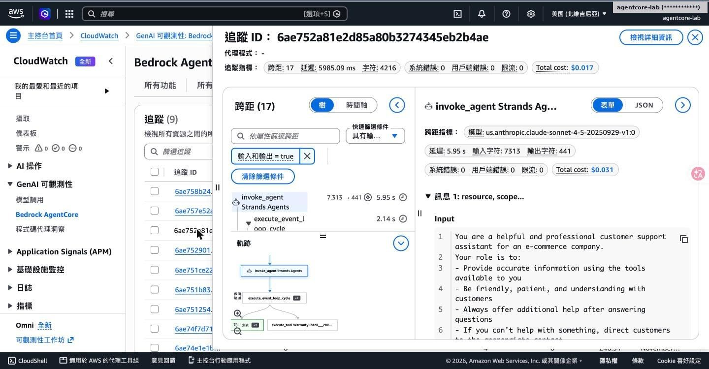

- invoke_agent → execute_event_loop_cycle → chat／execute_tool
- 看得到用了哪個模型、輸入輸出字元數與成本
- execute_tool WarrantyCheck___check_warranty 即 Gateway 工具
- 完全不用改程式，OpenTelemetry 自動埋點

---

[← 回到 README](../README.md)
