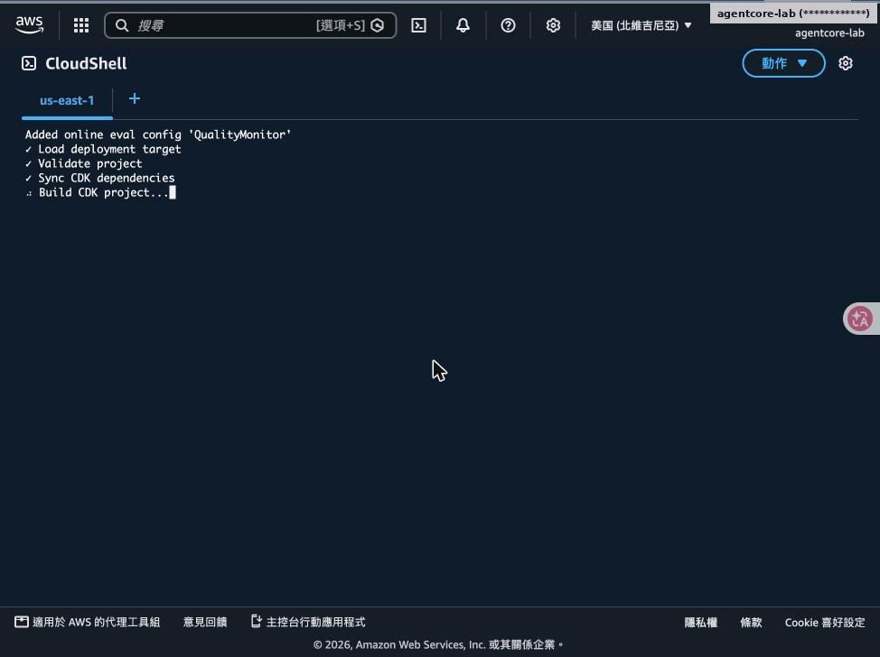
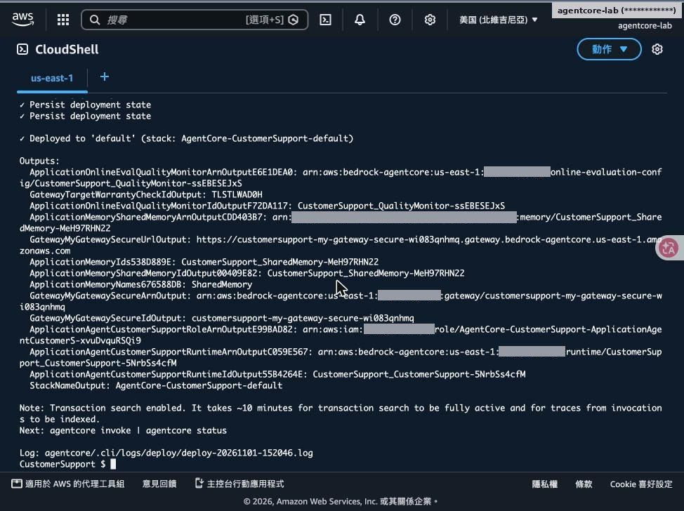
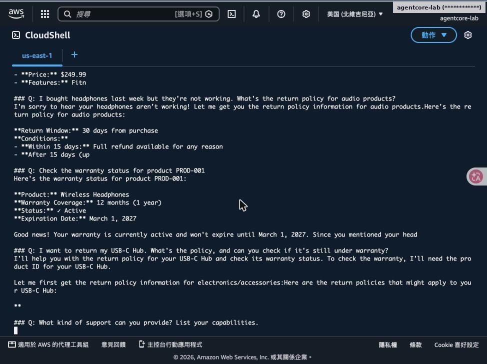
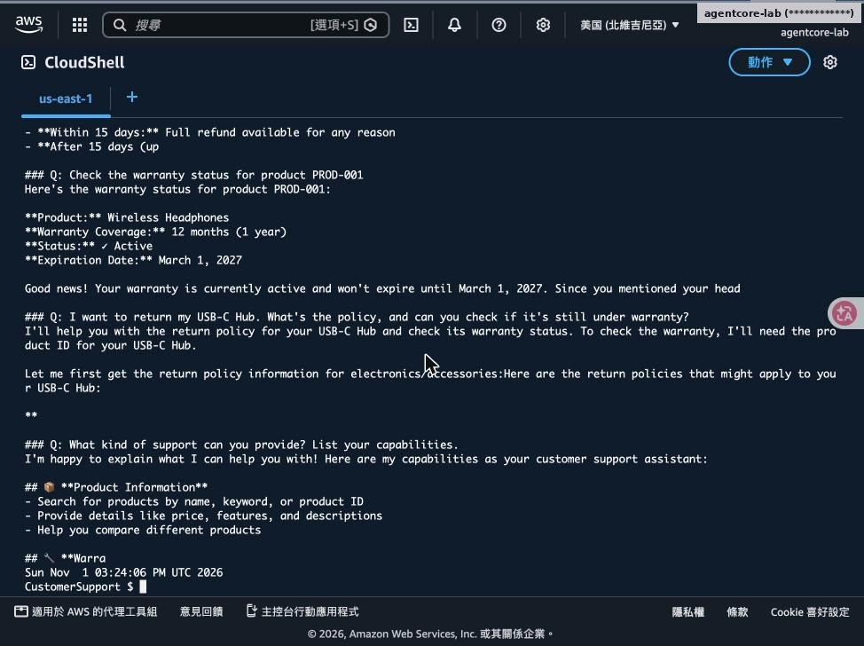
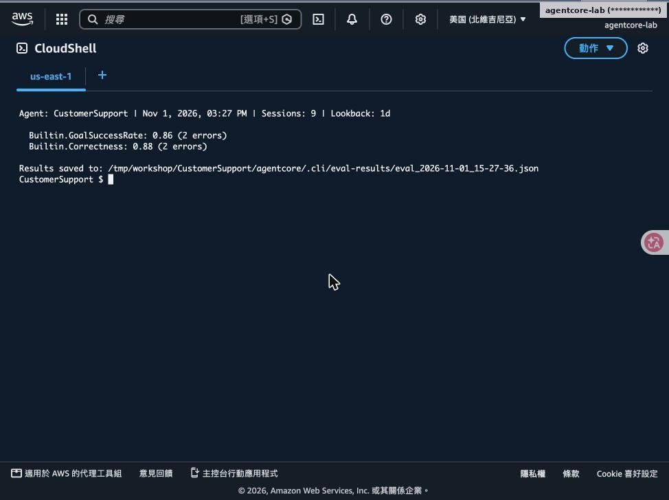
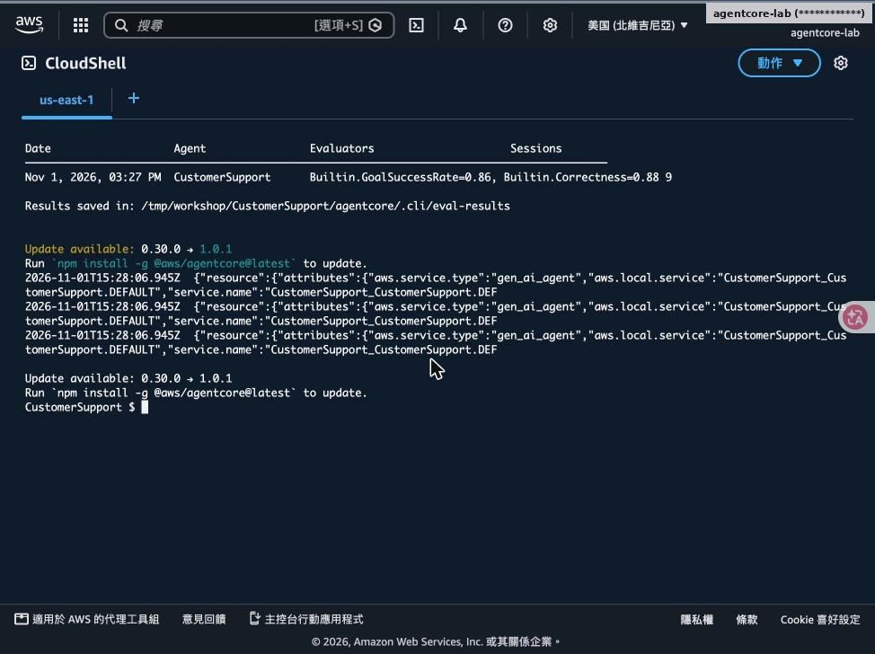

# Lab 5｜評估 Agent 品質

> [前置準備](00-prerequisites.md)・[Lab 1](01-lab1-prototype.md)・[Lab 2](02-lab2-memory.md)・[Lab 3](03-lab3-gateway.md)・[Lab 4](04-lab4-security-observability.md)・[Lab 5](05-lab5-evaluations.md)・[Lab 6](06-lab6-frontend.md)・[Lab 7](07-lab7-policy.md)・[清理與總結](08-cleanup-and-findings.md)

- 線上評估：持續抽樣打分數
- 隨需評估：針對一段時間的 Session 批次評分

對應腳本：[`scripts/lab5.sh`](../scripts/lab5.sh)

## Step 1–2：新增線上評估並部署

add online-eval QualityMonitor：GoalSuccessRate、Correctness、ToolSelectionAccuracy，抽樣 100%

部署後輸出 online-evaluation-config ARN

## Step 3：產生 5 筆測試互動

智慧手錶、耳機退貨、PROD-001 保固、USB-C Hub 退貨…

最後一題列出 Agent 能力。注意：音訊類政策回答「15 天內任何理由全額退款」，與工具資料不完全一致

## Step 4：隨需評估結果

| 指標 | 分數 |
|---|---|
| GoalSuccessRate | 0.86 |
| Correctness | 0.88 |
| 評估 Session 數 | 9（各 2 筆評估錯誤） |

分數未達 1.0，呼應前面觀察到的回答偏差：工具資料正確，模型轉述時仍可能出錯。

> agentcore run eval --runtime CustomerSupport --evaluator Builtin.GoalSuccessRate Builtin.Correctness --days 1

## Step 5：評估歷史與線上評估日誌

- agentcore evals history：每次隨需評估的分數與 Session 數
- 結果也存在 agentcore/.cli/eval-results/*.json
- agentcore logs evals：QualityMonitor 持續寫入的評估事件
- 可在 CloudWatch 對分數設警示

---

[← 回到 README](../README.md)
