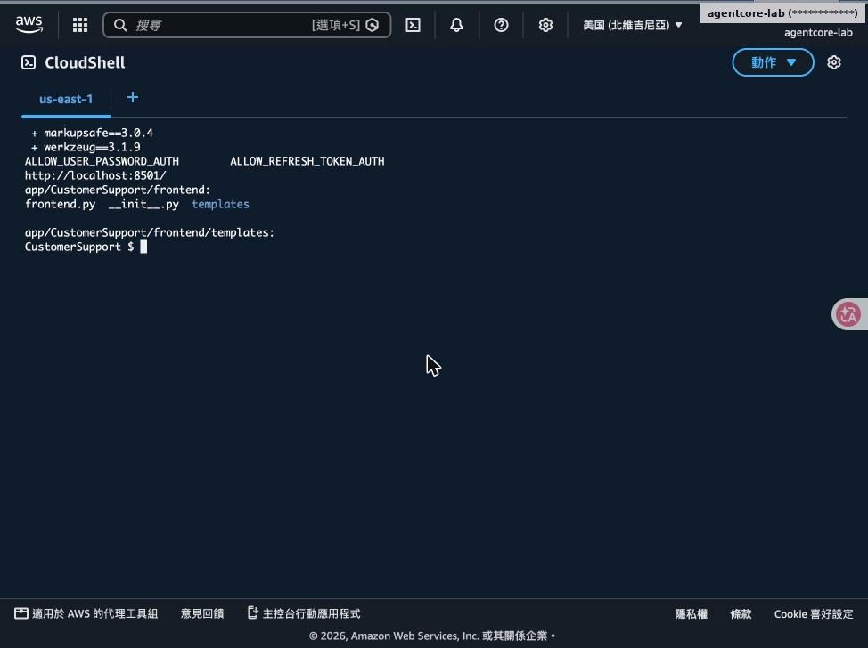
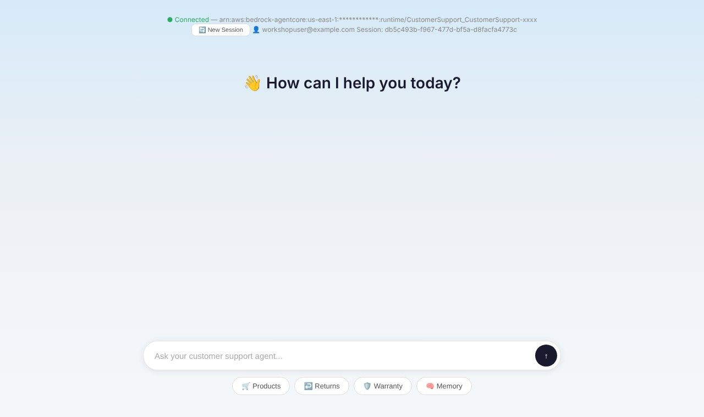
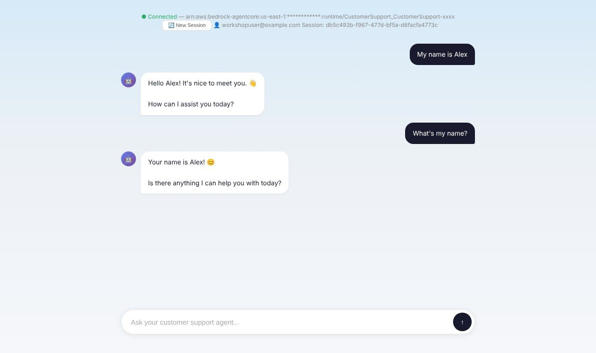
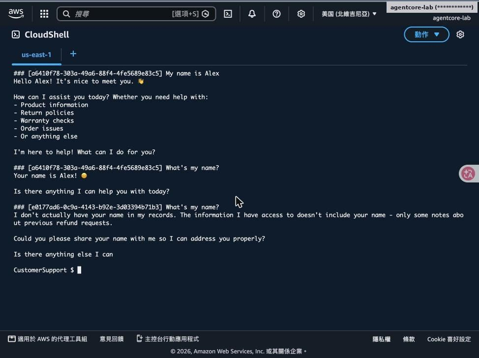

# Lab 6｜客戶聊天介面

> [前置準備](00-prerequisites.md)・[Lab 1](01-lab1-prototype.md)・[Lab 2](02-lab2-memory.md)・[Lab 3](03-lab3-gateway.md)・[Lab 4](04-lab4-security-observability.md)・[Lab 5](05-lab5-evaluations.md)・[Lab 6](06-lab6-frontend.md)・[Lab 7](07-lab7-policy.md)・[清理與總結](08-cleanup-and-findings.md)

- Flask 伺服器向 Cognito 取 Token 並注入頁面
- 瀏覽器直接呼叫 AgentCore REST API

對應腳本：[`scripts/lab6.sh`](../scripts/lab6.sh)

## Step 1：安裝套件並設定 Cognito Web Client

- uv add flask boto3 requests
- 建立 frontend/frontend.py 與 templates/index.html
- update-user-pool-client：允許 USER_PASSWORD_AUTH、callback http://localhost:8501/

> 💡 **重點**：為何不用 boto3？invoke_agent_runtime 走 SigV4，JWT 模式的 Runtime 需要 Authorization: Bearer，所以改用 requests／fetch。

## Step 2：聊天頁（index.html）

初始畫面：快速按鈕（商品、退貨、保固、記憶）。以工作坊 index.html 本機渲染，ARN 已遮蔽

對話示意：內容取自下一頁 curl 實測的回應

> CloudShell 無法把 8501 埠開給瀏覽器，所以 UI 截圖是用同一份 index.html 在本機渲染，API 行為以 curl 實測。

## Step 3：以 curl 做聊天頁做的事：Session 延續

- POST /runtimes/{ARN}/invocations?qualifier=DEFAULT
- Header：Authorization Bearer＋Runtime-Session-Id
- 同一 Session：「我叫 Alex」→「我叫什麼？」→ 答 Alex
- 新 Session：不知道名字（只找到先前的退款紀錄記憶）

---

[← 回到 README](../README.md)
