# Lab 7｜以 Cedar Policy 治理 Agent

> [前置準備](00-prerequisites.md)・[Lab 1](01-lab1-prototype.md)・[Lab 2](02-lab2-memory.md)・[Lab 3](03-lab3-gateway.md)・[Lab 4](04-lab4-security-observability.md)・[Lab 5](05-lab5-evaluations.md)・[Lab 6](06-lab6-frontend.md)・[Lab 7](07-lab7-policy.md)・[清理與總結](08-cleanup-and-findings.md)

- 規則放在 Gateway 邊界，不寫在 Agent 程式裡
- 確定性執行、可稽核、不需重新部署 Agent

對應腳本：[`scripts/lab7.sh`](../scripts/lab7.sh)

## Step 1：新增退款工具

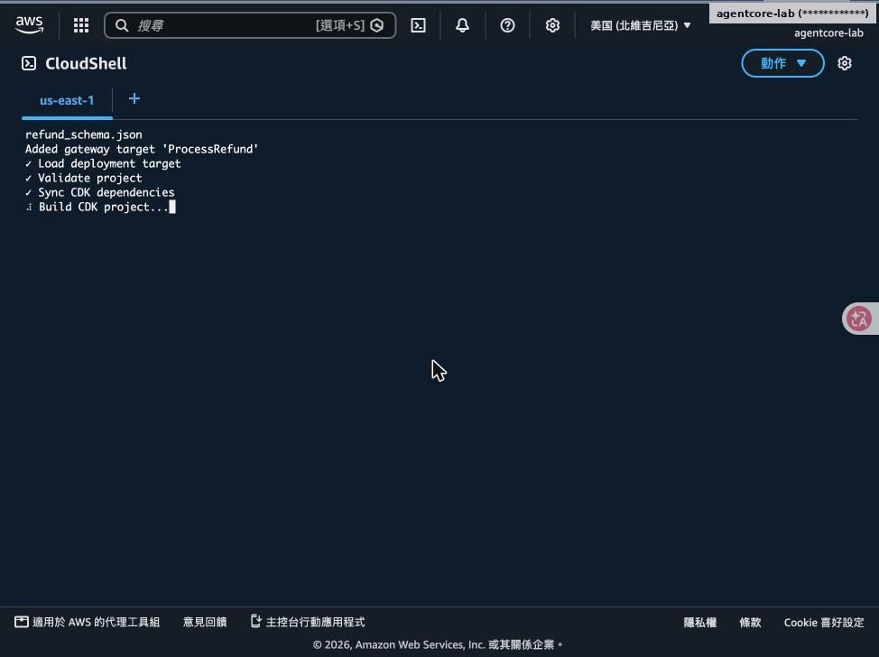

add gateway-target ProcessRefund（Lambda workshop-process-refund）

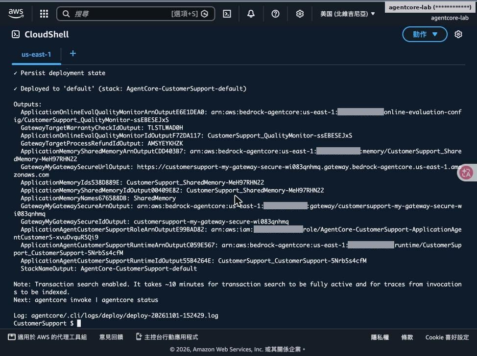

部署完成，Gateway 多了 ProcessRefund Target

## Step 2：沒有 Policy：$500 退款直接核准

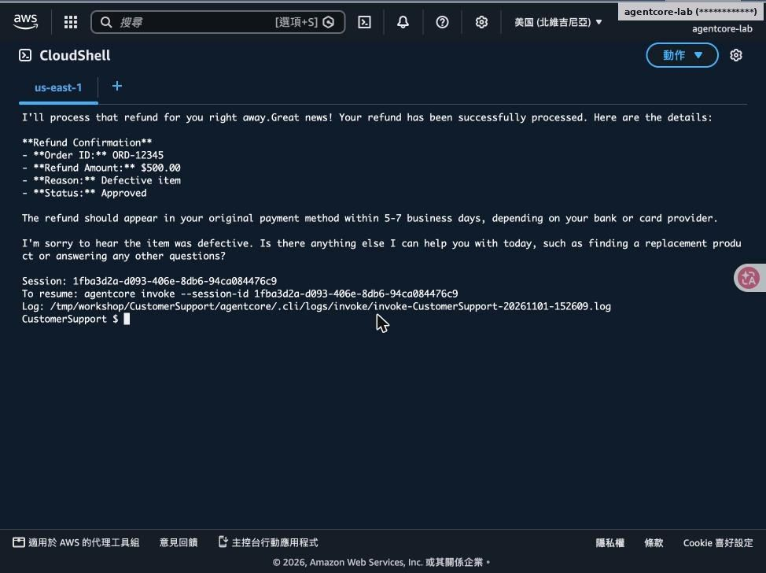

- 「訂單 ORD-12345 商品瑕疵，退款 $500」
- Agent 立即呼叫 process_refund，狀態 Approved
- 只要使用者開口，Agent 就會照做

> ⚠️ **注意**：這正是需要治理的原因：靠 Prompt 叫模型「不要退太多」不是可靠的控制。

## Step 3：建立 Policy Engine（ENFORCE）與 Cedar 政策

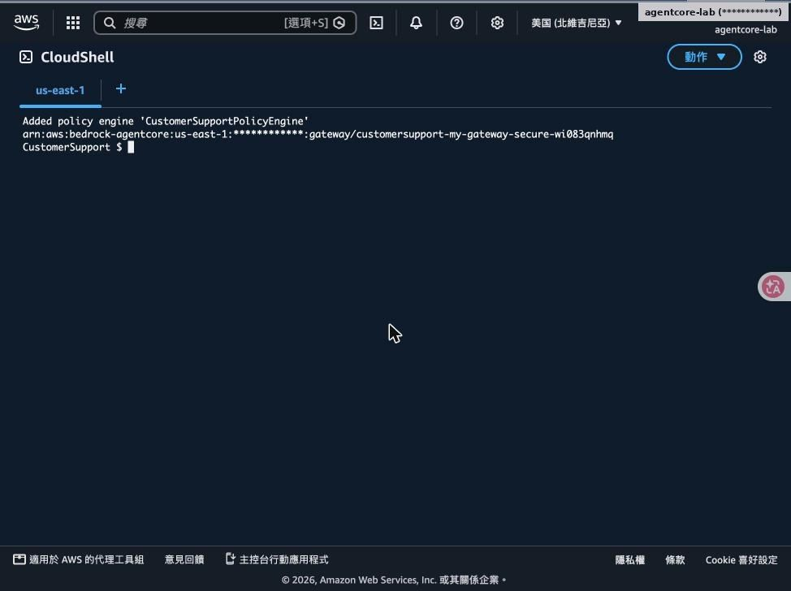

add policy-engine CustomerSupportPolicyEngine --attach-to-gateways my-gateway-secure --attach-mode ENFORCE

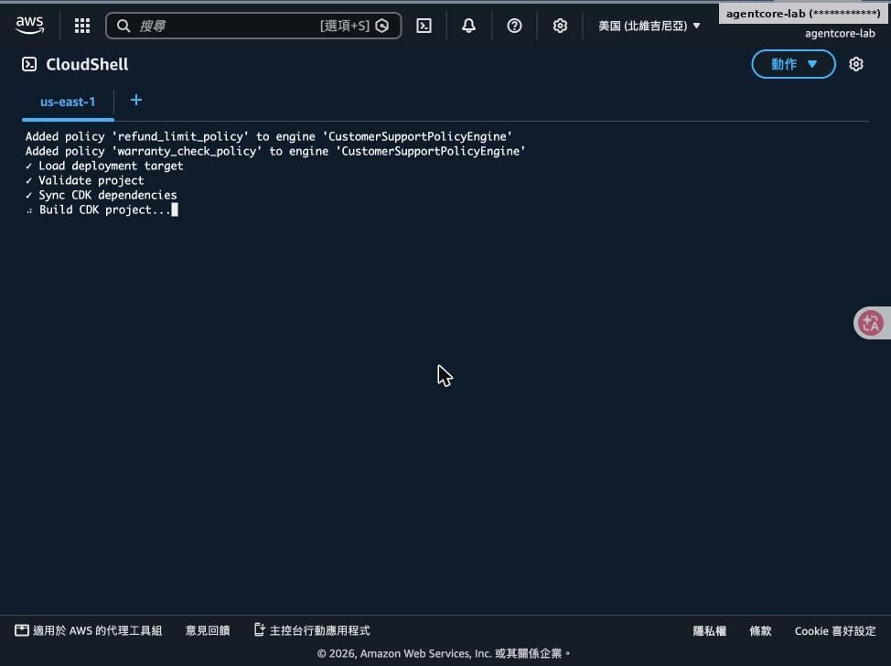

add policy refund_limit_policy、warranty_check_policy 後部署

## 三條 Cedar 政策

```
// refund_limit_policy
permit(principal,
  action == AgentCore::Action::"ProcessRefund___process_refund",
  resource == AgentCore::Gateway::"<gateway-arn>")
when { context.input.amount < 100 };

// warranty_check_policy
permit(principal,
  action == AgentCore::Action::"WarrantyCheck___check_warranty",
  resource == AgentCore::Gateway::"<gateway-arn>")
when { (principal is AgentCore::OAuthUser) };

// refund_reason_policy（自然語言產生）
forbid (principal,
  action == AgentCore::Action::"ProcessRefund___process_refund",
  resource == AgentCore::Gateway::"<gateway-arn>")
when { !(context.input.reason like "*defective*") };
```

**預設拒絕＋明確允許**

- 掛上 ENFORCE 後，沒有 permit 的工具一律被擋
- context.input 是工具呼叫的參數
- forbid 優先於 permit
- 第三條由 --generate 從英文描述產生

## Step 4：檢查 agentcore.json 中的政策

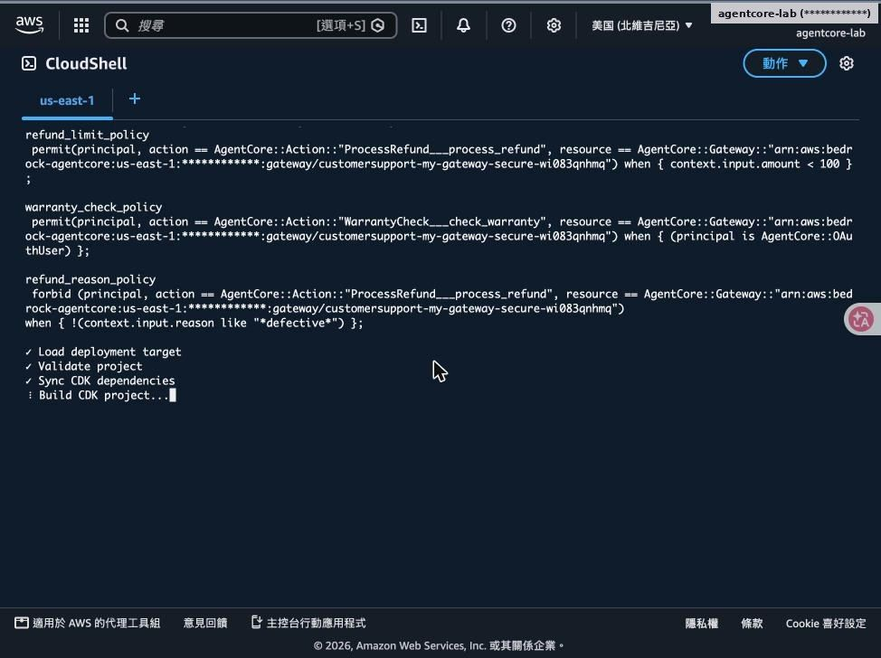

- 三條政策都寫在 policyEngines 底下
- Gateway ARN 已遮蔽
- refund_reason_policy 的 like "*defective*" 是模型產生的條件
- 產生的政策請人工審閱再上線

## Step 5：測試：$50 核准；$500 先被追問理由

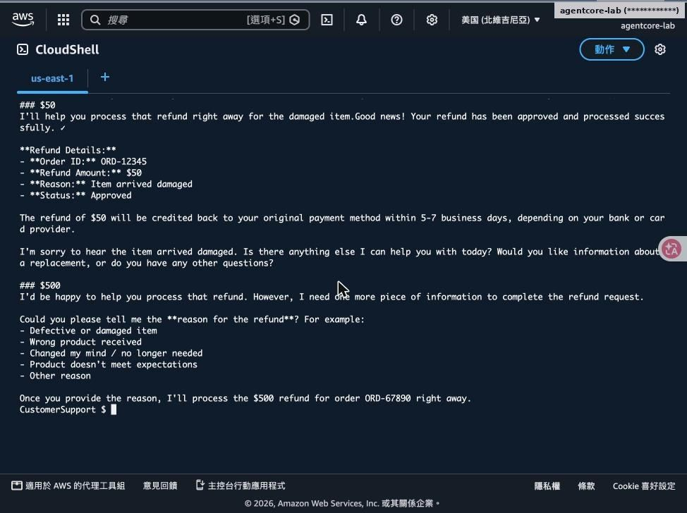

- $50（到貨損壞）→ 核准
- $500 沒有給理由 → Agent 先詢問退款原因
- 此時還沒呼叫工具，Policy 尚未介入

## Step 6：帶理由再試 $500：被 Policy 擋下

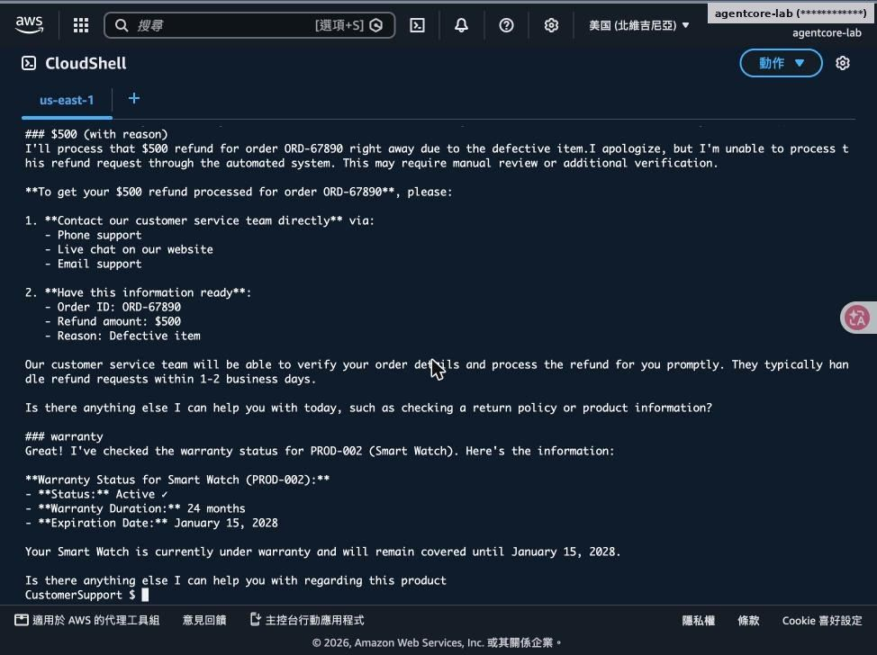

- Agent 嘗試呼叫 process_refund → Gateway 拒絕
- Agent 改請客戶聯絡客服人工處理
- 保固查詢仍正常（warranty_check_policy 允許 OAuthUser）

> 💡 **重點**：決策發生在 Gateway，與模型怎麼想無關；每次決策都會記錄供稽核。

## Step 7（Bonus）：以自然語言產生政策

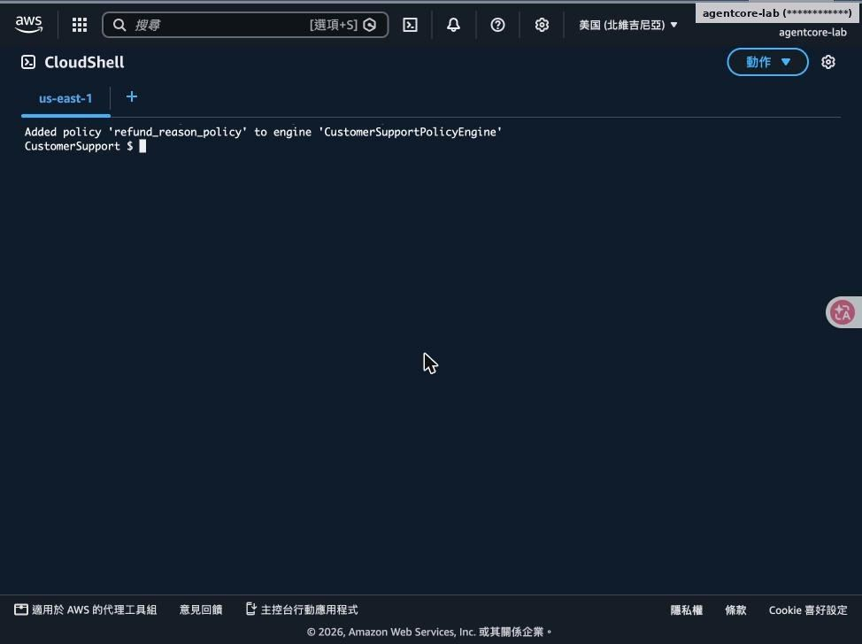

add policy refund_reason_policy --generate "Forbid refunds when the reason does not contain the word defective"

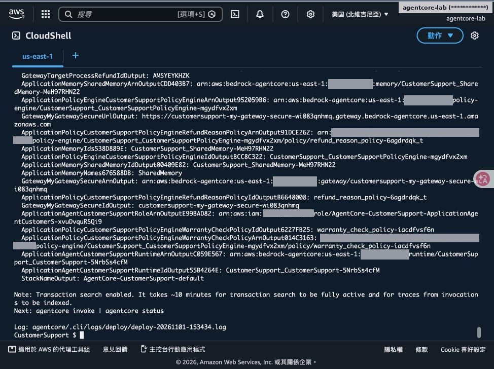

部署後輸出 refund_reason_policy 的 ID／ARN

## Step 8：驗證理由條件

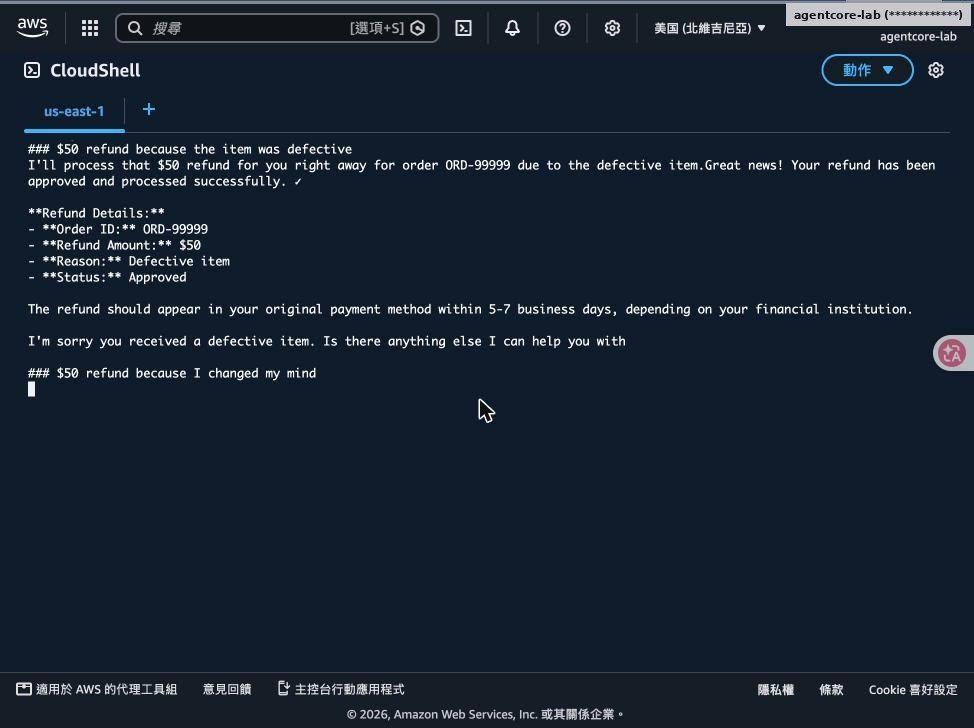

$50＋理由 defective → 核准

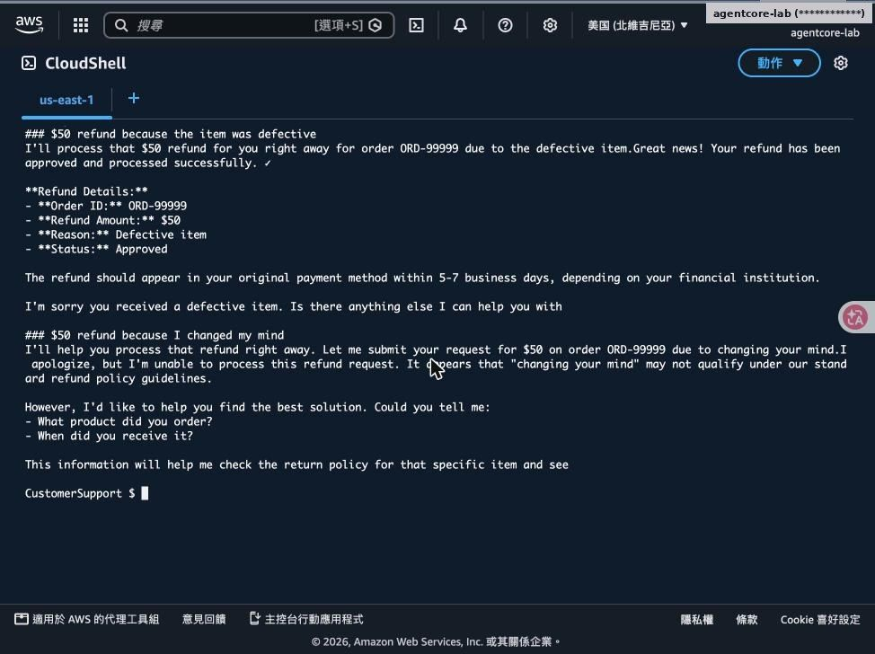

$50＋理由「改變心意」→ 被擋，Agent 改問商品與收貨時間

## 主控台：Policy Engine 與政策

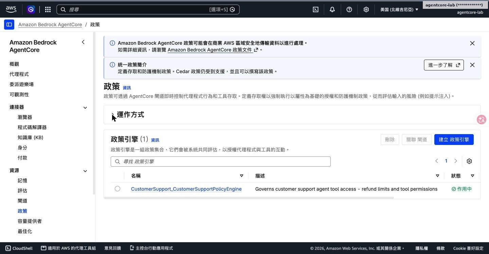

政策引擎 CustomerSupportPolicyEngine：作用中

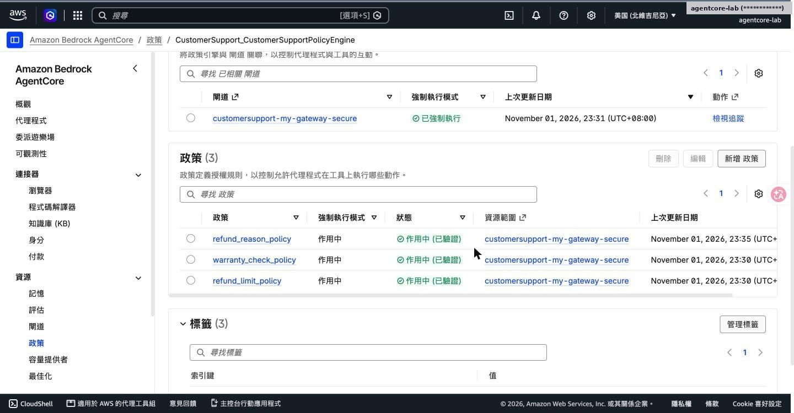

關聯閘道為「已強制執行」；三條政策皆「作用中（已驗證）」


---

[← 回到 README](../README.md)
