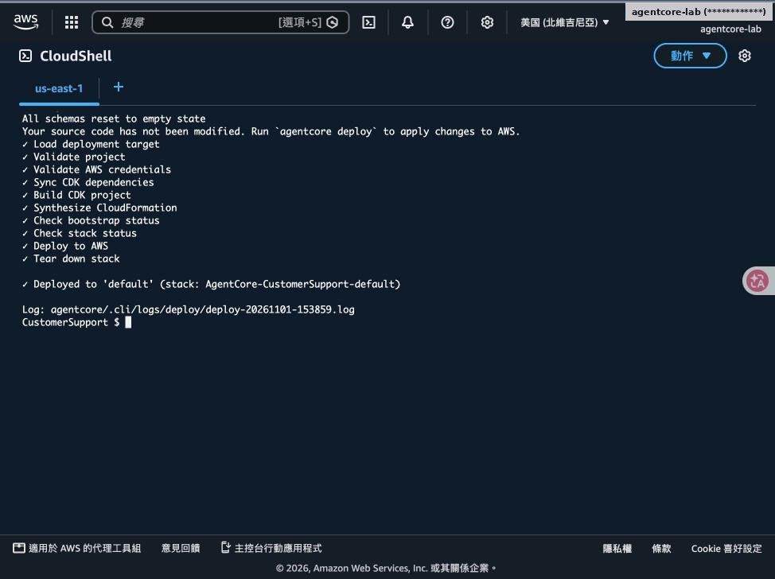
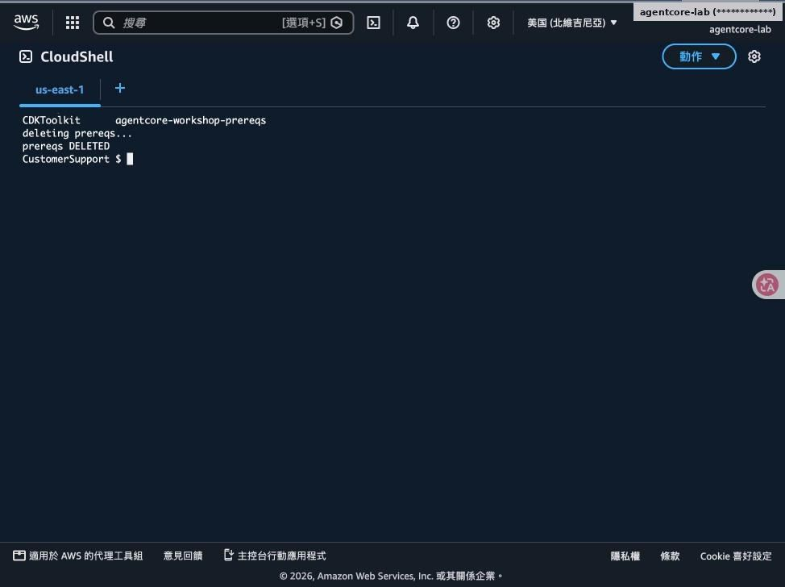
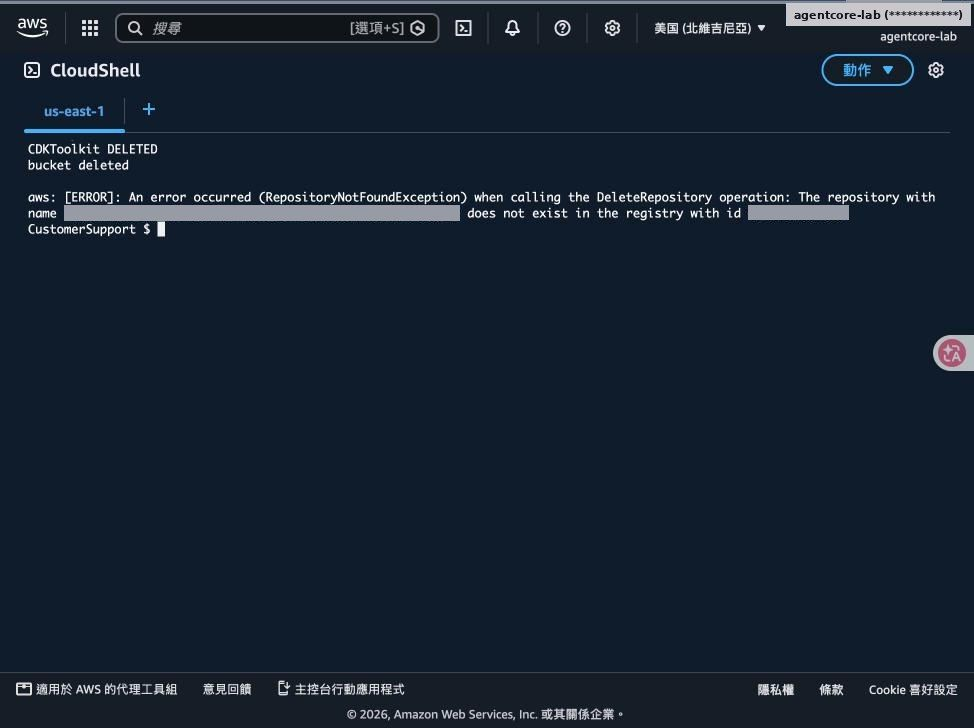
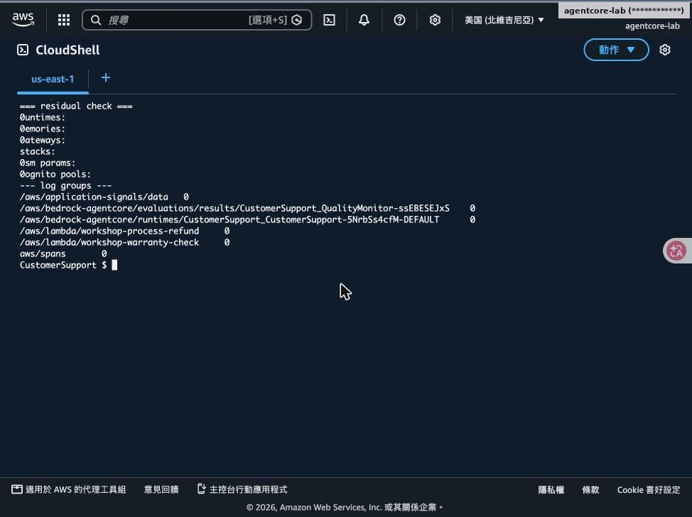
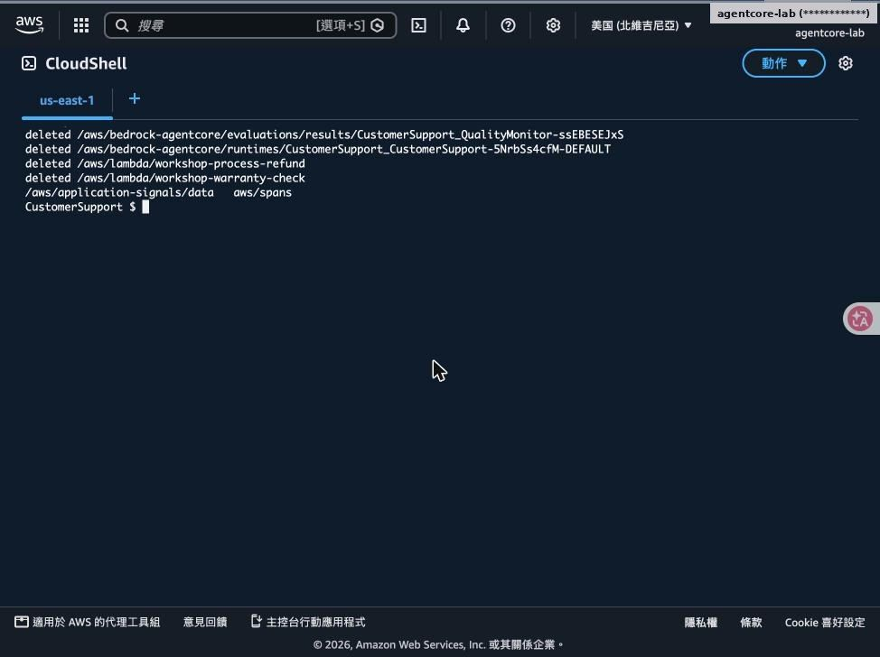

# 清理與總結

> [前置準備](00-prerequisites.md)・[Lab 1](01-lab1-prototype.md)・[Lab 2](02-lab2-memory.md)・[Lab 3](03-lab3-gateway.md)・[Lab 4](04-lab4-security-observability.md)・[Lab 5](05-lab5-evaluations.md)・[Lab 6](06-lab6-frontend.md)・[Lab 7](07-lab7-policy.md)・[清理與總結](08-cleanup-and-findings.md)

- 依工作坊 Clean Up 步驟移除所有資源
- 實測發現與導入建議

對應腳本：[`scripts/99-cleanup.sh`](../scripts/99-cleanup.sh)

## Step 1–2：移除 AgentCore 資源與前置堆疊

agentcore remove all -y → agentcore deploy：Tear down stack

delete-stack agentcore-workshop-prereqs：Cognito、Lambda、IAM、SSM 一併刪除

## Step 3–4：CDKToolkit 與殘留檢查

刪除 CDKToolkit 並清空資產 S3 桶（ECR 已隨堆疊刪除）

Runtime／Memory／Gateway／堆疊／SSM／Cognito 皆為 0；剩下 4 個日誌群組

## Step 5：刪除工作坊產生的日誌群組

- /aws/bedrock-agentcore/runtimes/…、evaluations/results/…
- /aws/lambda/workshop-*
- 保留 aws/spans、/aws/application-signals/data（Transaction Search 帳號層級）

> ⚠️ **注意**：Transaction Search 與 X-Ray 100% 索引是帳號設定，不再使用時可在 CloudWatch 關閉或調低比例。

## 實測發現與注意事項

| # | 發現 | 影響 | 建議 |
|---|---|---|---|
| 1 | 新帳號使用 Anthropic 模型需先送 use case；Sonnet 5.5 送出後仍未開通 | Lab 1 卡在 AccessDenied | 提早送表單；load.py 保留可切換的模型 ID |
| 2 | agentcore deploy 接管線（\| tail）看不到進度 | 誤以為卡住而中斷 | deploy 不要接管線，或加 -v 直接輸出 |
| 3 | 主控台若在其他分頁開了 CloudShell 面板，會奪走同一 Session | 終端機 detached | 只保留一個 CloudShell 分頁 |
| 4 | 模型轉述偶有偏差（耳機類別、音訊退貨條件） | 評估分數 0.86／0.88 | 以線上評估持續監控，關鍵規則放 Policy |
| 5 | 沒有 Policy 時 $500 退款直接核准 | 業務風險 | 金額、權限類規則一律放 Gateway Policy |
| 6 | Lab 2 的自訂 User-Id Header 可被偽造 | 記憶可能被冒用 | 正式環境以 JWT sub 當 actor（Lab 4 做法） |

## 導入到企業／金融場景的建議

**身分先行**

- Runtime 與 Gateway 都用 JWT
- actor_id 取自 Token，不信任自訂 Header
- 前端用 Authorization Code＋PKCE

**治理放在邊界**

- 金額上限、角色限制寫成 Cedar
- 預設拒絕，逐一 permit
- AI 產生的政策需人工審閱

**工具重用**

- 既有 Lambda／API 透過 Gateway 變 MCP 工具
- 不改原系統程式
- Schema 描述就是工具文件

**記憶要有邊界**

- 依 actor 分區，設定過期天數
- 評估哪些個資可以被記住
- 符合資料保存規範

**可觀測＋可評估**

- Trace 自動產生，無需埋點
- 線上評估分數設警示
- 保留決策紀錄供稽核

**成本與清理**

- 索引比例依環境調整
- 實驗結束跑 99-cleanup.sh
- 日誌群組需另外刪除

## Repo 對照：腳本與程式碼

github.com/ChunPingWang/aws-agentcore-tutorial

| 路徑 | 內容 |
|---|---|
| scripts/00-setup-cloudshell.sh | CloudShell 工具鏈：Node 22、uv、AgentCore CLI 0.30.0；路徑改到 /tmp |
| scripts/lab1.sh … lab7.sh | 每個 Lab 的完整指令（MODEL=sonnet45 預設改用 Sonnet 4.5） |
| scripts/lab4-user-token.sh | 建立 Cognito 測試使用者並把 Token 寫入 $WORK/.token（由操作者本人執行） |
| scripts/99-cleanup.sh | remove all＋deploy、刪除前置堆疊、選用刪除 CDKToolkit、殘留檢查 |
| labs/lab1 … lab7 | 工作坊程式碼：main.py、session.py、client.py、schema、frontend.py、index.html |
| docs/、docs/images/ | Step by Step 文件與已遮蔽帳號 ID 的截圖；本簡報 PPTX |

## 謝謝

---

[← 回到 README](../README.md)
